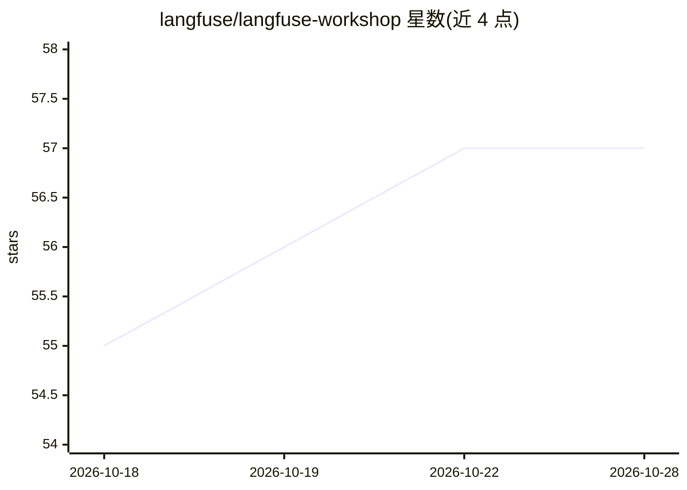

# langfuse/langfuse-workshop

⭐ 59 · TypeScript · MIT · 推送 2026-10-22 · [GitHub](https://github.com/langfuse/langfuse-workshop) · [官网](https://langfuse.com/workshop) · 组织维护

**端到端 Langfuse 工作坊：用 TypeScript 示例应用讲授 AI 工程闭环**

基于一个 TypeScript 示例应用（Dad IT Support Agent，OpenAI tool-calling 循环加两个本地工具）的分步工作坊，覆盖 Langfuse 的追踪、提示管理、监控、数据集、实验与评估全流程。提供自学者课程（docs/learner/）、讲师笔记（docs/instructor/）、准备材料与 9 个 checkpoint 标签，main 分支含完整参考实现。建议使用 Langfuse Cloud 以匹配课程内容，自托管实例可能版本较旧。以仓库形式提供，MIT 许可。

## 筛选速览

| 维度 | 判定 | 备注 |
|---|---|---|
| AI 角色 | `ai-knowledge` | 知识聚合/清单类 |
| 许可风险 | `permissive` | MIT |
| 部署形态 | `None` |  |
| 模型依赖 | — | README 未给出锁定关系 |
| 硬件要求 | — | 无带数字的原话,不猜 |
| 安装摩擦 | `low` | 无编译、无系统依赖或容器化 |
| 成熟度 | — | 结构信号不足 |

## 能力要点

- 9 个模块覆盖 tracing 到 evaluation 的完整 AI 工程闭环
- OpenAI tool-calling 循环的 TypeScript 参考实现（main 分支）
- 同时提供自学者课程与讲师授课笔记、准备幻灯
- 每个模块有独立 checkpoint，可单独学习某一环节

## 适用场景

- 自学 LLM 应用的追踪、提示管理与评估工作流
- 团队内部培训讲授 Langfuse 与 LLMOps 实践
- 参考完整 TypeScript 示例实现复用代码模式

## 场景标签

`教程课程` `LLM 可观测性` `模型评测` `提示工程` · 领域:Agent 开发

## 证据(README 行号)

> L3: # Langfuse Workshop - the AI engineering loop, end to end
> L5: This is a step-by-step Langfuse workshop built on a small TypeScript sample application: the **Dad IT Support Agent*

## 星数曲线

2026-10-18 55 → 2026-10-28 57（+2）

---
*卡片 v1 · prompt 1.4 · 生成 2026-10-24 · 置信度 high · 依据 README sha `157969e84538` · [字段定义](../../DATASET.md)*
