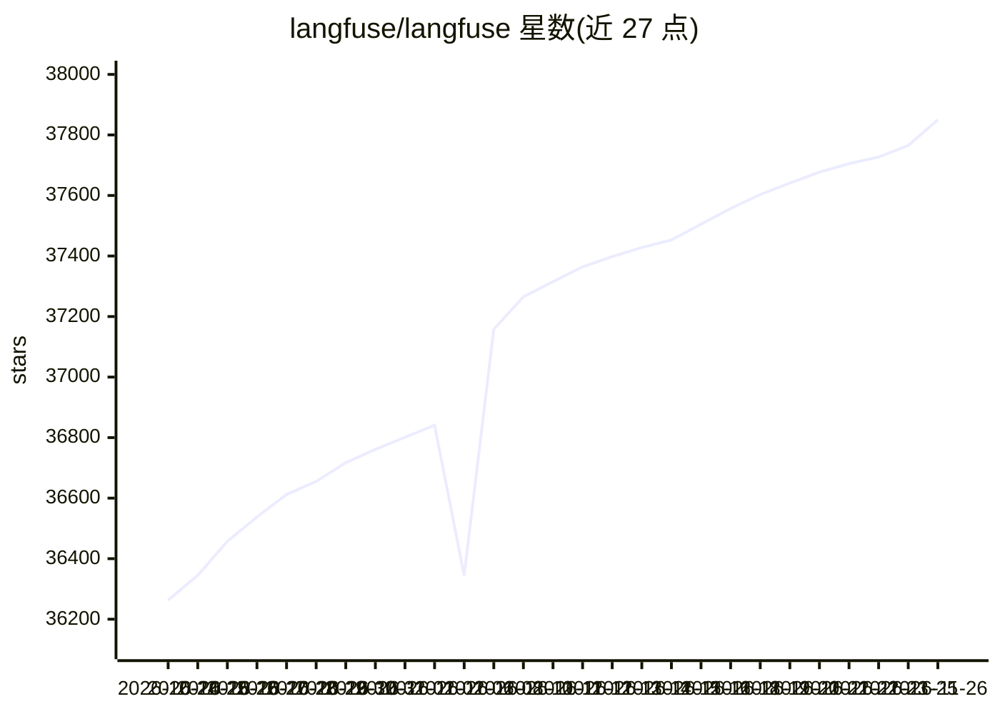

# langfuse/langfuse

⭐ 37,850 · TypeScript · NOASSERTION · 推送 2026-11-25 · [GitHub](https://github.com/langfuse/langfuse) · [官网](https://langfuse.com) · 组织维护

**面向 AI 工程团队的可观测、评测与提示管理平台**

开源 AI 工程平台，提供 Agent 可观测性、评测、提示/技能管理与 AI 网关，基于 OpenTelemetry 构建。通过 SDK 集成追踪 LLM 调用、检索与 Agent 行为；支持 LLM-as-a-judge、代码评估器、用户反馈与人工标注等多种评测方式；提示中心化管理、版本控制并配 Playground 迭代；AI 网关统一模型调用端点、集中管理凭证并追踪开销。可使用官方云服务或通过 Docker Compose、Kubernetes Helm 自托管，提供 Python/JS SDK 与 OpenAPI。

## 筛选速览

| 维度 | 判定 | 备注 |
|---|---|---|
| AI 角色 | `ai-ecosystem` | LLM/agent 周边工具 |
| 许可风险 | `none` | NOASSERTION |
| 部署形态 | `self-host` | docker 或自建部署 |
| 模型依赖 | — | README 未给出锁定关系 |
| 硬件要求 | — | 无带数字的原话,不猜 |
| 安装摩擦 | `low` | 无编译、无系统依赖或容器化 |
| 成熟度 | `idea` | |

## 动量与使用信号

- 维护:`active` — 距上次 push 1.0 天,年发版 100,221 位贡献者
- 涨星:近 1 天 **+65**(自 20261016 起算)
- 安装:pypi 包 `langfuse` 月下载 23,563,200
- 平台:— · 协议:MCP / OLLAMA

## 能力要点

- 基于 OpenTelemetry 的 LLM 调用与应用逻辑追踪
- 提示中心化版本管理与 LLM Playground
- 支持 LLM-as-a-judge、代码评估器、人工标注等多种评测方式
- AI 网关统一模型调用端点并追踪开销

## 适用场景

- 追踪和调试生产环境中的 LLM 应用与 Agent 行为
- 集中管理提示版本并通过数据集做上线前评测
- 自托管平台统一追踪公司内所有 AI 调用与开销

## 场景标签

`LLM 可观测性` `模型评测` `提示工程` `模型网关` · 领域:Agent 开发

## 证据(README 行号)

> L49: Langfuse is an **open source AI engineering platform** for **agent evals and observability**. It is one open platfo
> L64: - AI Observability: Instrument your app and start ingesting traces to Langfuse, thereby tracking LLM calls and othe
> L72: - AI Gateway (beta) gives your organization one endpoint for calls to your model providers. Keep provider credentia

## 星数曲线

2026-10-24 36,263 → 2026-11-26 37,850（+1,587）

---
*卡片 v1 · prompt 1.4 · 生成 2026-11-22 · 置信度 mid · 依据 README sha `5e383e1b68a7` · [字段定义](../../DATASET.md)*
