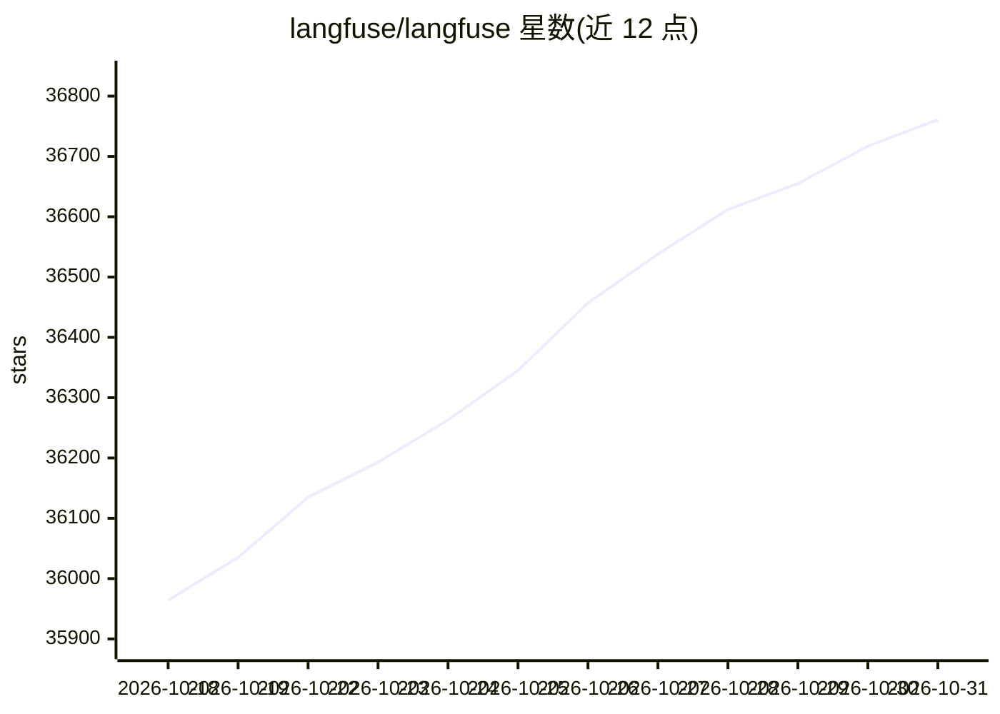

# langfuse/langfuse

⭐ 36,761 · TypeScript · NOASSERTION · 推送 2026-10-30 · [GitHub](https://github.com/langfuse/langfuse) · [官网](https://langfuse.com) · 组织维护

**LLM 应用的开源追踪与评估平台：开发、监控、调试 AI 应用**

开源 LLM 工程平台，供团队协作开发、监控、评估和调试 AI 应用。核心机制包括：应用埋点摄入 trace 以跟踪 LLM 调用、检索、嵌入与 agent 动作；集中式 Prompt 管理与版本控制（服务端/客户端缓存）；支持 LLM-as-a-judge、代码评估器、用户反馈、人工标注等评估方式；数据集支持测试集与基准；LLM Playground 迭代提示词。可通过 Docker Compose、Kubernetes (Helm) 或 Terraform 自托管，也提供 Langfuse Cloud 托管版与 Python/JS-TS SDK。

## 筛选速览

| 维度 | 判定 | 备注 |
|---|---|---|
| AI 角色 | `ai-native` | 本体是模型或模型工具 |
| 许可风险 | `none` | NOASSERTION |
| 部署形态 | `self-host` | docker 或自建部署 |
| 模型依赖 | — | README 未给出锁定关系 |
| 硬件要求 | — | 无带数字的原话,不猜 |
| 安装摩擦 | `low` | 无编译、无系统依赖或容器化 |
| 成熟度 | — | 结构信号不足 |

## 动量与使用信号

- 维护:`active` — 距上次 push 1.0 天,年发版 100,221 位贡献者
- 涨星:近 1 天 **+65**(自 20261016 起算)
- 安装:pypi 包 `langfuse` 月下载 23,563,200
- 平台:— · 协议:MCP / OLLAMA

## 能力要点

- 可观测性：摄取 trace 跟踪 LLM 调用、检索、嵌入与 agent 动作
- Prompt 集中管理与版本控制，含服务端与客户端缓存
- 评估支持 LLM-as-a-judge、代码评估器、用户反馈、人工标注与自定义管线
- 提供 Python/JS-TS SDK、OpenAPI 规范与 Postman 集合

## 适用场景

- 为我的 LLM 应用接入 trace 追踪，检查复杂日志和用户会话
- 用数据集和 LLM-as-a-judge 在部署前测试评估我的应用
- 自托管一套平台集中管理团队提示词与评估流程

## 场景标签

`提示工程` `LLM 可观测性` · 领域:LLM 基础设施/可观测性与评估

## 证据(README 行号)

> L49: Langfuse is an **open source LLM engineering** platform. It helps teams collaboratively
> L62: - LLM Application Observability: Instrument your app and start ingesting traces to Langfuse, thereby tracking LLM c
> L74: ## 📦 Deploy Langfuse

## 星数曲线

2026-10-18 35,964 → 2026-10-31 36,761（+797）

---
*卡片 v1 · prompt 1.4 · 生成 2026-10-18 · 置信度 high · 依据 README sha `7620421440d4` · [字段定义](../../DATASET.md)*
