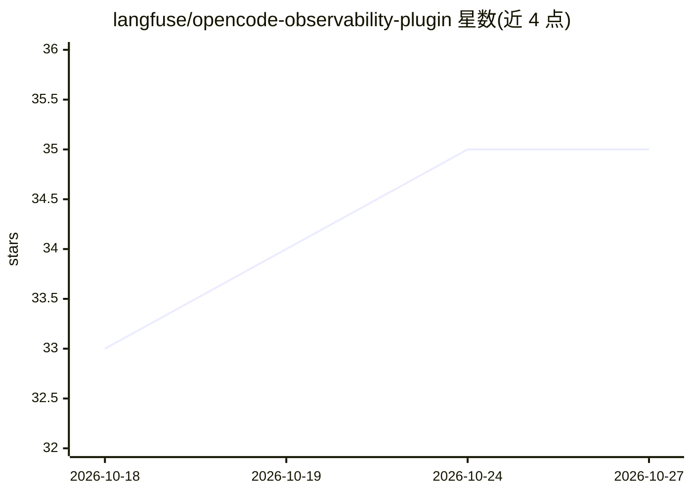

# langfuse/opencode-observability-plugin

⭐ 35 · TypeScript · MIT · 推送 2026-10-23 · [GitHub](https://github.com/langfuse/opencode-observability-plugin) · [官网](https://langfuse.com/) · 组织维护

**将 OpenCode 会话遥测发送到 Langfuse 的观测插件**

OpenCode 插件，将 OpenCode 会话的用户轮次、助手生成、工具调用、重试、推理输出、压缩输出及失败步骤的追踪数据发送到 Langfuse（云版或自托管）。通过在 OpenCode 配置中声明插件包启用，同时兼容 OpenCode 1（server() 实现）与 OpenCode 2（setup() 实现），经版本 2.0.4 / 1.18.29 验证。凭据可由配置文件或环境变量提供。要求 Node.js 22 或更新版本及 Langfuse 4.59.0 或更新版本。

## 筛选速览

| 维度 | 判定 | 备注 |
|---|---|---|
| AI 角色 | `ai-ecosystem` | LLM/agent 周边工具 |
| 许可风险 | `permissive` | MIT |
| 部署形态 | `None` |  |
| 模型依赖 | — | README 未给出锁定关系 |
| 硬件要求 | — | 无带数字的原话,不猜 |
| 安装摩擦 | `low` | 无编译、无系统依赖或容器化 |
| 成熟度 | — | 结构信号不足 |

## 能力要点

- 追踪用户轮次、生成、工具调用、重试、推理与压缩输出、失败步骤
- 同一包兼容 OpenCode 1 与 OpenCode 2
- 凭据支持配置文件与环境变量两种方式，可选 baseUrl/environment

## 适用场景

- 在 Langfuse 中观测 OpenCode 编码代理会话
- 排查失败的生成步骤与重试
- 自托管 Langfuse 环境下接入 OpenCode 遥测

## 场景标签

`LLM 可观测性` · 领域:评测与运维

## 证据(README 行号)

> L3: OpenCode plugin that sends OpenCode session telemetry to Langfuse. It traces user turns, assistant generations, tool
> L27: Requires Node.js 22 or newer and Langfuse Cloud or self-hosted Langfuse 4.59.0

## 星数曲线

2026-10-18 33 → 2026-10-27 35（+2）

---
*卡片 v1 · prompt 1.4 · 生成 2026-10-25 · 置信度 high · 依据 README sha `e83c80c580a7` · [字段定义](../../DATASET.md)*
