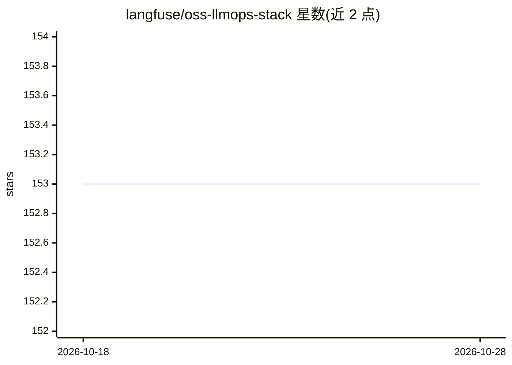

# langfuse/oss-llmops-stack

⭐ 153 · MIT · 推送 2026-07-28 · [GitHub](https://github.com/langfuse/oss-llmops-stack) · [官网](https://oss-llmops-stack.com) · 组织维护

**开源模块化 LLMOps 技术栈：LiteLLM 网关 + Langfuse 可观测**

由 Langfuse 维护的模块化开源 LLMOps 组合栈：按职责分离，LiteLLM 统一 LLM API、管理路由与成本控制并提供高可用通道；Langfuse 负责细粒度可观测性、prompt 版本管理与性能评估。面向需要自托管 LLM 网关与观测能力的开发者/团队。README 仅含标题与站点链接（oss-llmops-stack.com），安装方式、许可证等细节不可从可见文本验证。

## 筛选速览

| 维度 | 判定 | 备注 |
|---|---|---|
| AI 角色 | `ai-ecosystem` | LLM/agent 周边工具 |
| 许可风险 | `permissive` | MIT |
| 部署形态 | `None` |  |
| 模型依赖 | — | README 未给出锁定关系 |
| 硬件要求 | — | 无带数字的原话,不猜 |
| 安装摩擦 | `low` | 无编译、无系统依赖或容器化 |
| 成熟度 | — | 结构信号不足 |

## 能力要点

- LiteLLM 统一 LLM API 并管理路由与成本控制
- Langfuse 提供可观测性、prompt 版本管理与性能评估
- 自托管、模块化的技术栈组合

## 适用场景

- 自建统一的 LLM API 网关并做成本控制
- 对 LLM 应用做可观测性与 prompt 版本管理
- 搭建可自托管的 LLMOps 基础设施

## 场景标签

`模型网关` `LLM 可观测性` `提示工程` · 领域:Agent 开发

## 证据(README 行号)

> L1: # OSS LLMOps Stack

## 星数曲线

2026-10-18 153 → 2026-10-28 153（+0）

---
*卡片 v1 · prompt 1.4 · 生成 2026-10-22 · 置信度 low · 依据 README sha `965c98ea72ea` · [字段定义](../../DATASET.md)*
