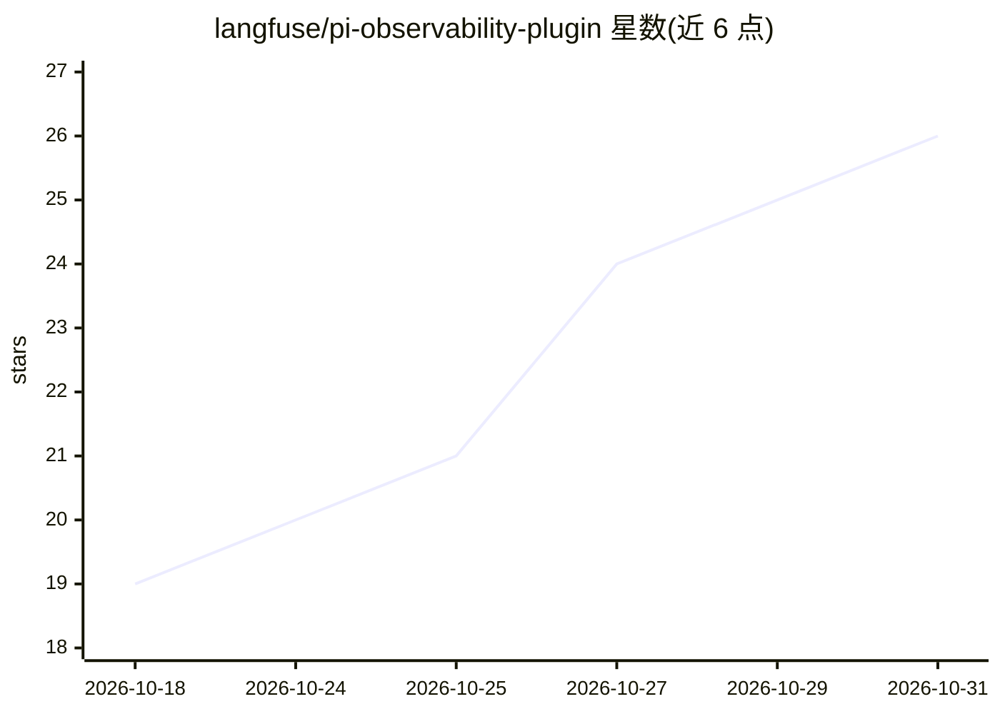

# langfuse/pi-observability-plugin

⭐ 26 · TypeScript · MIT · 推送 2026-10-22 · [GitHub](https://github.com/langfuse/pi-observability-plugin) · [官网](https://langfuse.com/integrations/developer-tools/pi-agent) · 组织维护

**将 pi 编码 agent 会话追踪上报 Langfuse 的观测插件**

Langfuse 官方为 pi 编码 agent 提供的可观测性扩展：监听 Pi 生命周期事件，把每个用户 prompt 作为一条 trace 发送到 Langfuse，记录 agent 轮次、模型生成的 token 用量（含缓存读取与推理拆分）、成本、首 token 时间、工具调用及嵌套子 agent，图片作为媒体上传并在 trace 内渲染。通过 pi install npm 包安装，凭据写入 ~/.pi/agent/langfuse.json 或环境变量，默认连 EU 云端，支持 OpenTelemetry 属性；声称为实验性版本，未来可能引入破坏性变更。

## 筛选速览

| 维度 | 判定 | 备注 |
|---|---|---|
| AI 角色 | `ai-ecosystem` | LLM/agent 周边工具 |
| 许可风险 | `permissive` | MIT |
| 部署形态 | `library` | 以包/库形式分发 |
| 模型依赖 | — | README 未给出锁定关系 |
| 硬件要求 | — | 无带数字的原话,不猜 |
| 安装摩擦 | `low` | 无编译、无系统依赖或容器化 |
| 成熟度 | `idea` | |

## 能力要点

- 每个用户 prompt 生成一条 trace，轮次编号在 Pi 重启后保留
- 记录 token 用量的 cache-read 与 reasoning 拆分及成本、首 token 时间
- 追踪工具调用（含失败时的 ERROR 级别）与嵌套子 agent
- 提供 LANGFUSE_TRACING_ENABLED 开关，关闭时不发送任何数据

## 适用场景

- 在 Langfuse 中查看 pi 编码 agent 的完整会话与成本
- 按团队成员、环境、版本标签切分 trace 做分析
- 排查工具调用失败与子 agent 行为

## 场景标签

`LLM 可观测性` · 领域:评测与运维

## 证据(README 行号)

> L3: This extension sends pi coding agent sessions to
> L16: The plugin listens to Pi's core lifecycle events and sends every user prompt to

## 星数曲线

2026-10-18 19 → 2026-10-31 26（+7）

---
*卡片 v1 · prompt 1.4 · 生成 2026-10-27 · 置信度 high · 依据 README sha `b44747c0980a` · [字段定义](../../DATASET.md)*
