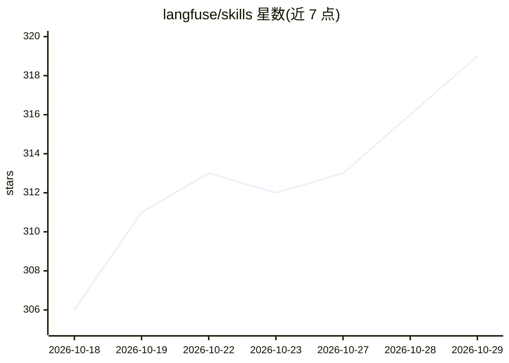

# langfuse/skills

⭐ 319 · Python · MIT · 推送 2026-10-27 · [GitHub](https://github.com/langfuse/skills) · [官网](https://langfuse.com/docs/api-and-data-platform/features/agent-skill) · 组织维护

**教 AI 编程助手使用 Langfuse 平台的 Agent 技能集**

Langfuse 官方维护的 Agent Skills 仓库：以 SKILL 文件形式教 Claude Code、Cursor 等 AI 编程助手如何操作 Langfuse——通过 API 查询与管理 traces、prompts、datasets、scores，查阅文档与最佳实践。含两条技能：主技能 langfuse 与迁移技能 migrate-to-langfuse（从 LangSmith、Arize、Braintrust 等平台迁移 tracing、数据集与评估器）。提供 Cursor 插件、npx skills CLI 与手动 symlink 三种安装方式，使用前需 Langfuse 账号与 API key。

## 筛选速览

| 维度 | 判定 | 备注 |
|---|---|---|
| AI 角色 | `ai-ecosystem` | LLM/agent 周边工具 |
| 许可风险 | `permissive` | MIT |
| 部署形态 | `library` | 以包/库形式分发 |
| 模型依赖 | — | README 未给出锁定关系 |
| 硬件要求 | — | 无带数字的原话,不猜 |
| 安装摩擦 | `low` | 无编译、无系统依赖或容器化 |
| 成熟度 | — | 结构信号不足 |

## 能力要点

- 两条技能：langfuse 主技能与 migrate-to-langfuse 迁移技能
- 通过 Langfuse API 查询/管理 traces、prompts、datasets、scores
- 三种安装途径：Cursor 插件、skills CLI、手动 symlink

## 适用场景

- 让 Claude Code / Cursor 在项目中接入和配置 Langfuse tracing
- 把现有 LLM 可观测平台的历史数据迁移到 Langfuse
- 通过 agent 查询 Langfuse 的 traces、提示词与数据集

## 场景标签

`LLM 可观测性` `模型评测` · 领域:评测与运维

## 证据(README 行号)

> L5: Agent Skills that teach AI coding assistants (Claude Code, Cursor, etc.) how to work with Langfuse — the open-source
> L11: |langfuse|Main skill to work with Langfuse. Query and manage traces, prompts, datasets, and scores via the Langfuse

## 星数曲线

2026-10-18 306 → 2026-10-29 319（+13）

---
*卡片 v1 · prompt 1.4 · 生成 2026-10-21 · 置信度 high · 依据 README sha `0936ee8401e3` · [字段定义](../../DATASET.md)*
