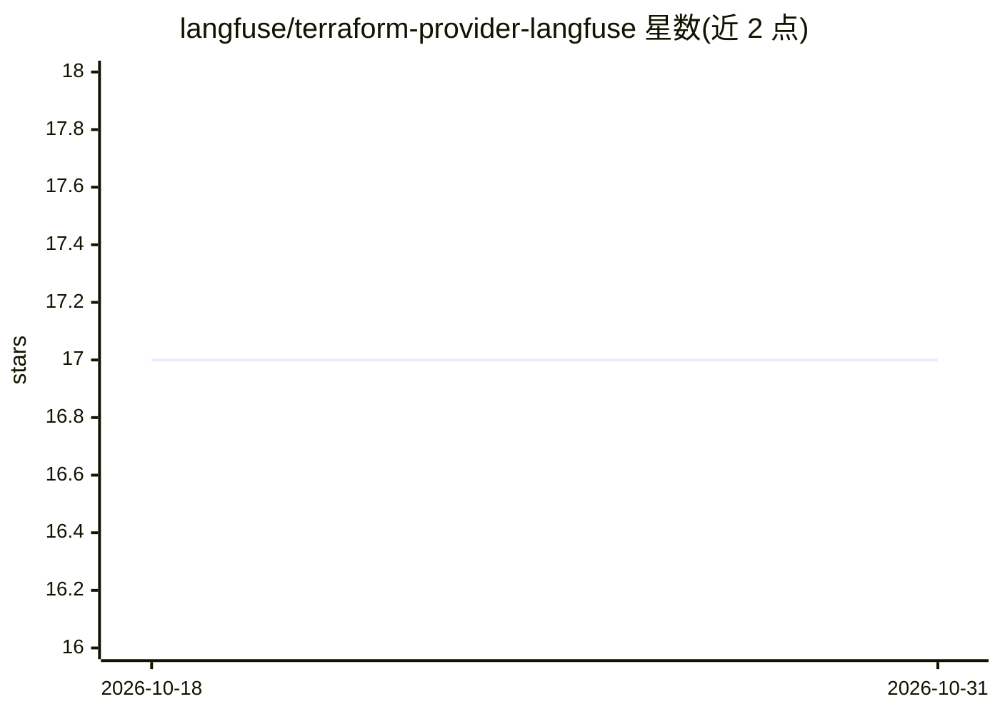

# langfuse/terraform-provider-langfuse

⭐ 17 · Go · MIT · 推送 2026-10-30 · [GitHub](https://github.com/langfuse/terraform-provider-langfuse) · [官网](https://langfuse.com/) · 组织维护

**用 Terraform 管理 Langfuse 组织/项目/API密钥/LLM连接的 Provider**

社区维护的 Terraform Provider，以基础设施即代码方式管理 Langfuse（开源 LLM 工程平台）的组织、项目、组织与项目级 API 密钥、成员关系及 LLM API 连接。要求 Terraform >= 1.5，开发需 Go >= 1.24；管理组织与组织 API 密钥时需自托管实例并持 Enterprise Edition 许可，云端实例不支持这两类资源。LLM 连接资源支持 OpenAI、Bedrock、Azure、Vertex AI 等适配器并按 provider 名做 upsert。

## 筛选速览

| 维度 | 判定 | 备注 |
|---|---|---|
| AI 角色 | `ai-ecosystem` | LLM/agent 周边工具 |
| 许可风险 | `permissive` | MIT |
| 部署形态 | `None` |  |
| 模型依赖 | — | README 未给出锁定关系 |
| 硬件要求 | — | 无带数字的原话,不猜 |
| 安装摩擦 | `low` | 无编译、无系统依赖或容器化 |
| 成熟度 | — | 结构信号不足 |

## 能力要点

- 组织/项目/成员/API 密钥 6 类 Terraform 资源
- LLM 连接管理：6 种适配器（anthropic/openai/azure/bedrock/google-vertex-ai/google-ai-studio）
- 成员资源经 SCIM 端点自动创建用户并管理角色
- 支持 SSH 隧道/端口转发场景的 tls_server_name 证书校验

## 适用场景

- 用 Terraform 声明式管理 Langfuse 多组织/多项目配置
- 把 LLM API 连接（含密钥）纳入 IaC 流程统一配置
- 批量管理团队成员的组织与项目角色

## 场景标签

 · 领域:LLM 基础设施/IaC

## 证据(README 行号)

> L3: A Terraform provider for managing Langfuse resources programmatically.
> L5: Langfuse is an open-source LLM engineering platform that provides observability, analytics, prompt management, and e

## 星数曲线

2026-10-18 17 → 2026-10-31 17（+0）

---
*卡片 v1 · prompt 1.4 · 生成 2026-10-30 · 置信度 high · 依据 README sha `5637a667c11f` · [字段定义](../../DATASET.md)*
