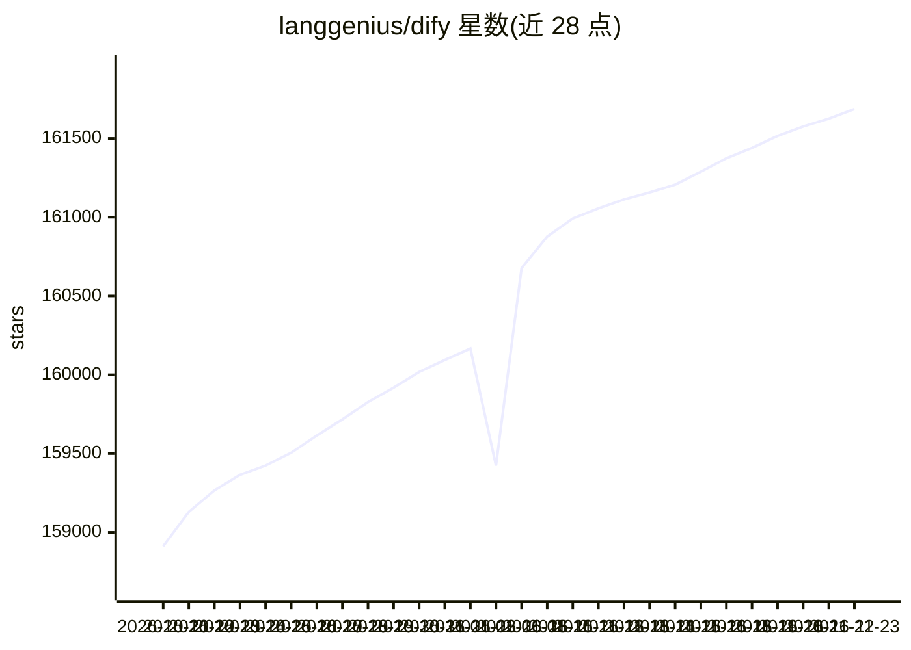

# langgenius/dify

⭐ 161,686 · Python · NOASSERTION · 推送 2026-11-22 · [GitHub](https://github.com/langgenius/dify) · [官网](https://dify.ai) · 组织维护 · 中文 README

**团队构建 AI 工作流与 RAG 应用的开源 LLM 开发平台**

开源 LLM 应用开发平台，在可视化画布上构建 AI 工作流与 RAG 管道，涵盖模型管理、Prompt IDE、自主 Agent（带沙箱，可执行命令/安装软件/处理文件）、LLMOps 日志观测与 Backend-as-a-Service API。支持接入数十家推理服务商的数百个专有与开源模型及任何 OpenAI API 兼容模型。通过 Docker Compose 自托管，也可使用官方 Cloud 或面向企业的 Enterprise 版（SSO/RBAC/支持 SLA）。最低系统要求为 2 核 CPU 与 4 GiB 内存。

## 筛选速览

| 维度 | 判定 | 备注 |
|---|---|---|
| AI 角色 | `ai-ecosystem` | LLM/agent 周边工具 |
| 许可风险 | `none` | NOASSERTION |
| 部署形态 | `self-host` | docker 或自建部署 |
| 模型依赖 | — | README 未给出锁定关系 |
| 硬件要求 | — | 无带数字的原话,不猜 |
| 安装摩擦 | `low` | 无编译、无系统依赖或容器化 |
| 成熟度 | — | 结构信号不足 |

## 动量与使用信号

- 维护:`active` — 距上次 push 0.6 天,年发版 26,456 位贡献者
- 涨星:近 1 天 **+97**(自 20261016 起算)
- 平台:— · 协议:OPENAI-API / MCP

## 能力要点

- 可视化画布构建与测试 AI 工作流
- 接入数百个专有/开源 LLM 与 OpenAI API 兼容模型
- RAG 管道覆盖文档摄取到检索，支持 PDF/PPT 文本抽取
- Agent 沙箱可运行命令、安装软件并接入 Marketplace 工具与 MCP 服务器

## 适用场景

- 搭建企业内部知识库问答与 RAG 应用
- 低代码编排多步骤 AI 工作流并接入自有业务 API
- 通过生产日志与标注持续迭代提示词和数据集

## 场景标签

`RAG` `工作流自动化` `Agent 框架` · 领域:Agent 开发

## 证据(README 行号)

> L58: Dify is an open-source LLM app development platform. Its intuitive interface combines AI workflow, RAG pipeline, ag
> L102: Seamless integration with hundreds of proprietary / open-source LLMs from dozens of inference providers and self-h
> L125: - **Self-hosting Dify Community Edition **

## 星数曲线

2026-10-21 158,912 → 2026-11-23 161,686（+2,774）

---
*卡片 v1 · prompt 1.4 · 生成 2026-11-22 · 置信度 high · 依据 README sha `2eb6048c32ff` · [字段定义](../../DATASET.md)*
