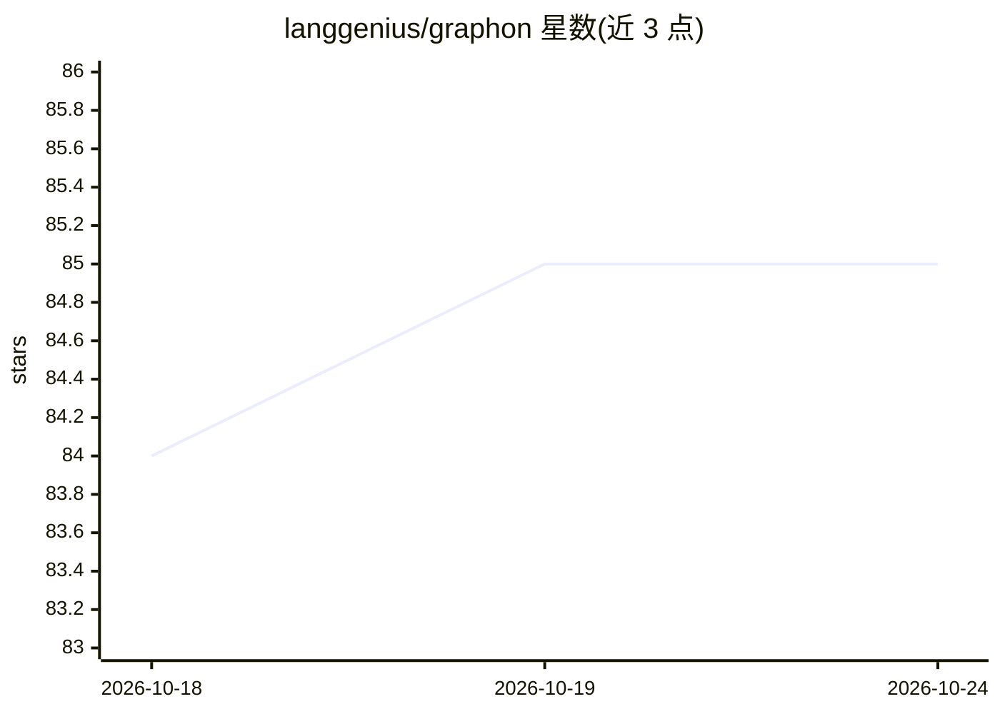

# langgenius/graphon

⭐ 85 · Python · Apache-2.0 · 推送 2026-10-24 · [GitHub](https://github.com/langgenius/graphon) · 组织维护

**面向 agentic AI 工作流的 Python 图执行引擎**

Graphon 是用于 agentic AI 工作流的 Python 图执行引擎：提供基于队列的 Engine 事件驱动编排、图解析与校验、fluent 图构建、共享运行时状态与变量池，以及常见工作流模式的内置节点。支持 DSL 导入与 Slim 支撑的 LLM 节点，另含 HTTP、文件、工具与人工输入的集成协议。README 附带一个可运行的端到端示例（含 DSL 导入与直接 Python 图构建两条路径）。仓库自述仍处于演进阶段。Apache-2.0 许可。

## 筛选速览

| 维度 | 判定 | 备注 |
|---|---|---|
| AI 角色 | `ai-ecosystem` | LLM/agent 周边工具 |
| 许可风险 | `permissive` | Apache-2.0 |
| 部署形态 | `None` |  |
| 模型依赖 | — | README 未给出锁定关系 |
| 硬件要求 | — | 无带数字的原话,不猜 |
| 安装摩擦 | `low` | 无编译、无系统依赖或容器化 |
| 成熟度 | `idea` | |

## 能力要点

- 基于队列的 Engine 编排与事件驱动执行
- 图解析、校验与 fluent 图构建
- 内置工作流节点与共享运行时状态/变量池
- DSL 导入支持与 Slim 支撑的 LLM 节点

## 适用场景

- 用 Python 构建和执行 agentic AI 工作流图
- 通过 DSL 导入工作流并运行 LLM 节点
- 在自研 agent 应用中集成图执行引擎

## 场景标签

`工作流自动化` · 领域:效率与自动化

## 证据(README 行号)

> L3: Graphon is a Python graph execution engine for agentic AI workflows.
> L15: - DSL import support with Slim-backed LLM nodes

## 星数曲线

2026-10-18 84 → 2026-10-24 85（+1）

---
*卡片 v1 · prompt 1.4 · 生成 2026-10-24 · 置信度 high · 依据 README sha `60de791bd748` · [字段定义](../../DATASET.md)*
