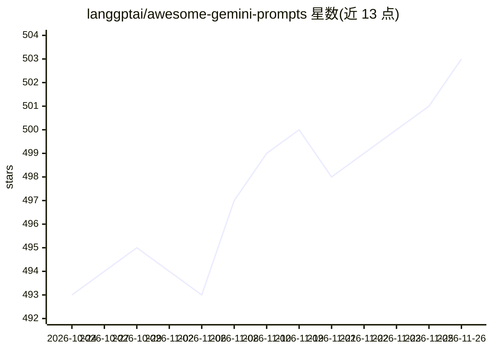

# langgptai/awesome-gemini-prompts

⭐ 503 · CC0-1.0 · 推送 2026-11-14 · [GitHub](https://github.com/langgptai/awesome-gemini-prompts) · [官网](https://www.langgpt.ai) · 个人维护 · 中文 README

**面向 Gemini 用户的提示词示例集合，含中文与思维链模板**

Gemini 模型的提示词示例集合：收录思维链模板、PDCA-ASK 学习法导师、Gemini 系统提示词、官方风格示例（学习计划、旅行、写作、调试、邮件）等，按主题分类，每个条目附来源链接。用户克隆仓库后直接将 README 中提示词作为 Gemini 输入使用。提供中文使用章节（加入指定语句规避乱码）与思考模型提示写法建议；末尾含 jailbreak 提示词分类。主要限制为纯文本集合，无代码或工具。

## 筛选速览

| 维度 | 判定 | 备注 |
|---|---|---|
| AI 角色 | `ai-knowledge` | 知识聚合/清单类 |
| 许可风险 | `viral` | CC0-1.0 |
| 部署形态 | `None` |  |
| 模型依赖 | — | README 未给出锁定关系 |
| 硬件要求 | — | 无带数字的原话,不猜 |
| 安装摩擦 | `low` | 无编译、无系统依赖或容器化 |
| 成熟度 | — | 结构信号不足 |

## 能力要点

- 多种主题的 Gemini 提示词示例，可直接复制使用
- 中文使用章节：加入指定语句规避语言乱码
- 思维链与思考模型提示写法指南，附飞书/DeepSeek 参考链接
- jailbreak 与系统提示词分类，标注 reddit/GitHub 来源

## 适用场景

- 为 Gemini 对话快速查找可用提示词模板
- 参考思维链模板引导模型多轮深入思考
- 中文场景下优化 Gemini 的中文输出质量

## 场景标签

`提示工程` `精选清单` · 领域:Agent 开发

## 证据(README 行号)

> L6: Welcome to the "Awesome Gemini Prompts" repository! This is a collection of prompt examples to be used with the Gemi
> L12: To get started, simply clone this repository and use the prompts in the README.md file as input for Gemini. You can
> L43: ## 中文使用

## 星数曲线

2026-10-24 493 → 2026-11-26 503（+10）

---
*卡片 v1 · prompt 1.4 · 生成 2026-11-25 · 置信度 high · 依据 README sha `0b885bacceef` · [字段定义](../../DATASET.md)*
