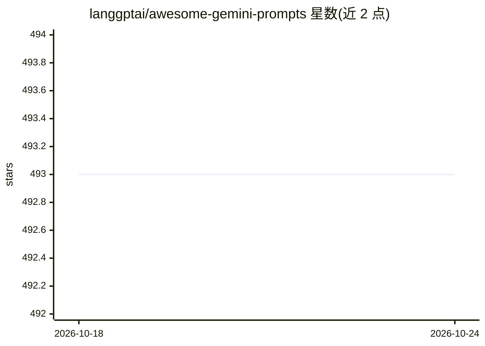

# langgptai/awesome-gemini-prompts

⭐ 493 · CC0-1.0 · 推送 2026-08-25 · [GitHub](https://github.com/langgptai/awesome-gemini-prompts) · [官网](https://www.langgpt.ai) · 个人维护 · 中文 README

**Gemini 模型的提示词示例合集（含中文与越狱提示）**

由云中江树（LangGPT 社区）维护的 Gemini 提示词集合：收录 Gemini 3/思考模型的提示写法建议、思维链引擎、PDCA-ASK 学习法导师、Gemini 2.5 系统提示词、Copilot 官方示例、研究助手以及 jailbreak 提示（含 Bard 时期的越狱与 badbard 提示），多带有来源链接。README 中英混排，提供中文使用建议（如加入简体中文回答指令规避乱码）。使用方式为克隆仓库后将提示词作为 Gemini 输入，也鼓励用户贡献自己的提示。

## 筛选速览

| 维度 | 判定 | 备注 |
|---|---|---|
| AI 角色 | `ai-knowledge` | 知识聚合/清单类 |
| 许可风险 | `viral` | CC0-1.0 |
| 部署形态 | `None` |  |
| 模型依赖 | — | README 未给出锁定关系 |
| 硬件要求 | — | 无带数字的原话,不猜 |
| 安装摩擦 | `low` | 无编译、无系统依赖或容器化 |
| 成熟度 | — | 结构信号不足 |

## 能力要点

- 覆盖 Gemini 3/思考模型的提示写法建议（目标与验收标准式描述）
- 收录思维链引擎、PDCA-ASK 学习法导师等中文提示词模板
- 包含 Gemini 2.5 系统提示词与 jailbreak 提示及其来源链接
- 附中文使用技巧（简体中文回答指令）

## 适用场景

- 为 Gemini 写提示词时参考现成模板
- 学习思考模型（Deep Think）下的提示词写法
- 查找特定场景（学习计划、写作、代码调试）的提示示例

## 场景标签

`提示工程` `精选清单` · 领域:Agent 开发

## 证据(README 行号)

> L6: Welcome to the "Awesome Gemini Prompts" repository! This is a collection of prompt examples to be used with the Gemi
> L10: In this repository, you will find a variety of prompts that can be used with Gemini. We encourage you to add your o

## 星数曲线

2026-10-18 493 → 2026-10-24 493（+0）

---
*卡片 v1 · prompt 1.4 · 生成 2026-10-22 · 置信度 high · 依据 README sha `d3f7dcc6815d` · [字段定义](../../DATASET.md)*
