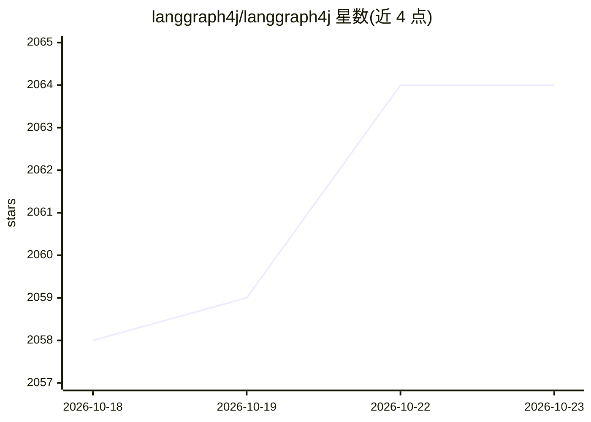

# langgraph4j/langgraph4j

⭐ 2,064 · Java · MIT · 推送 2026-10-22 · [GitHub](https://github.com/langgraph4j/langgraph4j) · [官网](https://langgraph4j.github.io/langgraph4j/) · 个人维护

**Java 版 LangGraph：用有环图构建有状态多 Agent 应用**

受 Python LangGraph 启发的 Java 库，用于构建有状态、多 Agent 的 LLM 应用，设计为与 Langchain4j 和 Spring AI 配合使用。核心机制：StateGraph 定义节点与边，支持有环图、条件路由、共享状态与 Reducer；可编译为可运行的 CompiledGraph，以 stream/invoke 执行；提供 CheckpointSaver 持久化（MySQL/PostgreSQL/Redis/MongoDB 模块）、PlantUML/Mermaid 图可视化，以及可嵌入的 Studio Web UI。要求 Java 17+，1.8.x 为 LTS 分支，1.9.x 含实验特性。

## 筛选速览

| 维度 | 判定 | 备注 |
|---|---|---|
| AI 角色 | `ai-ecosystem` | LLM/agent 周边工具 |
| 许可风险 | `permissive` | MIT |
| 部署形态 | `None` |  |
| 模型依赖 | — | README 未给出锁定关系 |
| 硬件要求 | — | 无带数字的原话,不猜 |
| 安装摩擦 | `medium` | 含编译或系统依赖之一 |
| 成熟度 | — | 结构信号不足 |

## 能力要点

- 支持有环图与条件路由的有状态执行模型
- Checkpoint 持久化（内存/MySQL/PostgreSQL/Redis/MongoDB saver 模块）
- PlantUML/Mermaid 图可视化与可嵌入 Studio Web UI
- 与 Langchain4j 和 Spring AI 集成

## 适用场景

- 在 Java 生态中构建带记忆与循环控制的 Agent 工作流
- 长时运行 Agent 流程的检查点保存与恢复
- 可视化调试与检视 Agent 图结构

## 场景标签

`Agent 框架` `多智能体` · 领域:Agent 开发

## 证据(README 行号)

> L7: LangGraph for Java. A library for building stateful, multi-agents applications with LLMs, built for work with [langc
> L33: LangGraph4j is a Java library for building stateful, multi-agent applications with Large Language Models (LLMs). It
> L35: At its core, LangGraph4j allows you to define cyclical graphs where different components (agents, tools, or custom 

## 星数曲线

2026-10-18 2,058 → 2026-10-23 2,064（+6）

---
*卡片 v1 · prompt 1.4 · 生成 2026-10-21 · 置信度 high · 依据 README sha `5bef95103bd8` · [字段定义](../../DATASET.md)*
