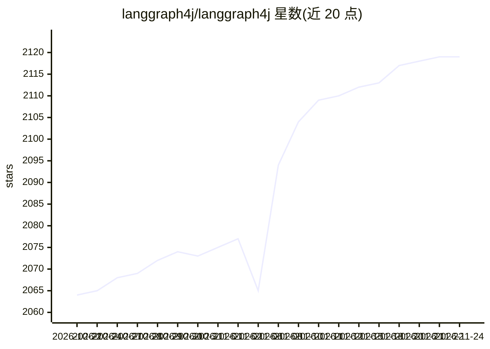

# langgraph4j/langgraph4j

⭐ 2,119 · Java · MIT · 推送 2026-11-23 · [GitHub](https://github.com/langgraph4j/langgraph4j) · [官网](https://langgraph4j.github.io/langgraph4j/) · 组织维护

**Java 版有状态多 Agent 图编排库，构建 LLM 智能体应用**

LangGraph4j 是一个 Java 库，用于构建基于 LLM 的有状态多智能体应用，设计上与 Langchain4j 和 Spring AI 框架协作。核心机制：StateGraph 定义节点与边（支持条件边与循环图）、AgentState 共享状态与 reducer 更新规则、编译为不可变的 CompiledGraph 运行，支持同步/异步、流式输出、Checkpoint 持久化（内存/MySQL/PostgreSQL/Redis/MongoDB/文件）、PlantUML/Mermaid 图可视化及 Studio Web 调试界面。发行线 1.9.x 为 Java 17+，1.8.x 分支提供 LTS 维护。

## 筛选速览

| 维度 | 判定 | 备注 |
|---|---|---|
| AI 角色 | `ai-ecosystem` | LLM/agent 周边工具 |
| 许可风险 | `permissive` | MIT |
| 部署形态 | `None` |  |
| 模型依赖 | — | README 未给出锁定关系 |
| 硬件要求 | — | 无带数字的原话,不猜 |
| 安装摩擦 | `medium` | 含编译或系统依赖之一 |
| 成熟度 | — | 结构信号不足 |

## 能力要点

- 支持循环图与条件边的有状态 Agent 编排
- Checkpoint 持久化支持 MySQL/PostgreSQL/Redis/MongoDB/文件等后端
- Studio Web UI 可视化检查、运行与调试图
- 与 Langchain4j 和 Spring AI 框架集成

## 适用场景

- 在 Java/Spring 项目中构建多 Agent 协作工作流
- 需要检查点恢复的长时运行 Agent 流程
- 通过可视化 Studio 调试 Agent 图结构

## 场景标签

`Agent 框架` `多智能体` · 领域:Agent 开发

## 证据(README 行号)

> L7: LangGraph for Java. A library for building stateful, multi-agents applications with LLMs, built for work with [langc
> L33: LangGraph4j is a Java library for building stateful, multi-agent applications with Large Language Models (LLMs). It
> L35: At its core, LangGraph4j allows you to define cyclical graphs where different components (agents, tools, or custom 

## 星数曲线

2026-10-22 2,064 → 2026-11-24 2,119（+55）

---
*卡片 v1 · prompt 1.4 · 生成 2026-11-23 · 置信度 high · 依据 README sha `c3b4333e216f` · [字段定义](../../DATASET.md)*
