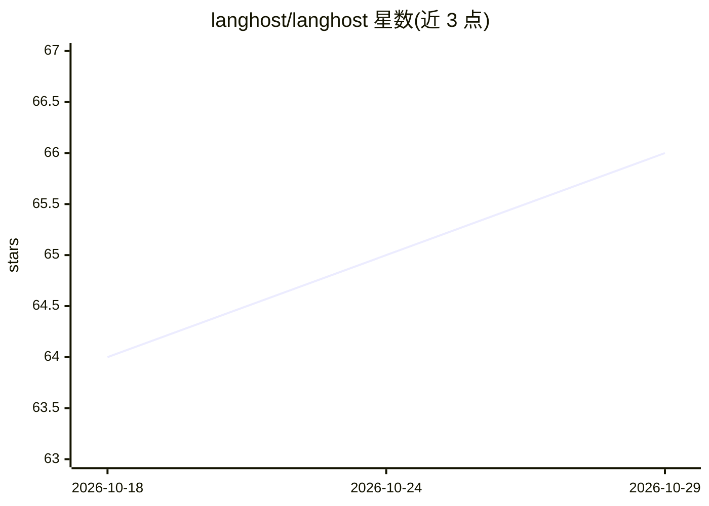

# langhost/langhost

⭐ 66 · Python · MIT · 推送 2026-10-01 · [GitHub](https://github.com/langhost/langhost) · [官网](https://github.com/langhost/langhost) · 个人维护

**自托管开源 LangGraph Agent Server 运行时：MIT 许可、Postgres+Redis 持久化**

面向已在使用 LangGraph 的开发者，提供可自托管的生产级 Agent Server：保留官方 langgraph-api 与 Agent Server 接口，将持久化层替换为 MIT 许可的 langgraph-runtime-pg（Postgres + Redis），现有 langgraph.json 项目无需改动代码即可迁移，免去商业许可密钥。CLI 提供 langhost serve 命令，兼容 LangSmith Studio、langgraph-sdk、MCP/A2A 等协议，支持多副本横向扩展与 Alembic 迁移。独立项目，非 LangChain 官方。

## 筛选速览

| 维度 | 判定 | 备注 |
|---|---|---|
| AI 角色 | `ai-ecosystem` | LLM/agent 周边工具 |
| 许可风险 | `permissive` | MIT |
| 部署形态 | `self-host` | docker 或自建部署 |
| 模型依赖 | — | README 未给出锁定关系 |
| 硬件要求 | — | 无带数字的原话,不猜 |
| 安装摩擦 | `low` | 无编译、无系统依赖或容器化 |
| 成熟度 | — | 结构信号不足 |

## 能力要点

- MIT 开源的 Postgres + Redis 持久化运行时（langgraph-runtime-pg），替换专有 runtime
- 现有 LangGraph 项目零代码改动，保留 langgraph.json 与官方 SDK/Studio
- 支持 MCP、A2A、Generative UI、webhooks、SSE 流式与多副本横向扩展
- 提供 langhost CLI（默认端口 31296）与 Alembic 数据库迁移管理

## 适用场景

- 把 LangGraph 应用从本地 langgraph dev 迁到自托管生产环境而不改代码
- 规避商业部署许可密钥，自管 Postgres/Redis 运行 Agent Server
- 在自托管环境中继续使用 LangSmith Studio 调试 agent

## 场景标签

 · 领域:LLM 基础设施/Agent 服务

## 证据(README 行号)

> L37: **langhost** is the open way to run a production-grade LangGraph Agent Server on **your** Postgres and Redis — no c
> L71: - **`langgraph-runtime-pg`** — the **backbone**: clean-room Postgres + Redis runtime (`LANGGRAPH_RUNTIME_EDITION=pg

## 星数曲线

2026-10-18 64 → 2026-10-29 66（+2）

---
*卡片 v1 · prompt 1.4 · 生成 2026-10-24 · 置信度 mid · 依据 README sha `79f82f03e751` · [字段定义](../../DATASET.md)*
