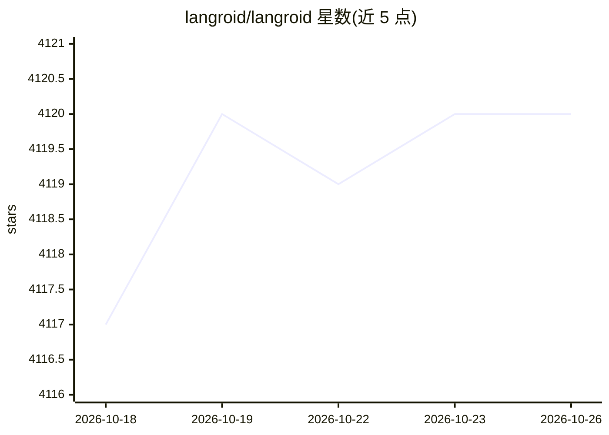

# langroid/langroid

⭐ 4,120 · Python · MIT · 推送 2026-10-25 · [GitHub](https://github.com/langroid/langroid) · [官网](https://langroid.github.io/langroid/) · 组织维护

**构建 LLM 多智能体应用的 Python 框架，出自 CMU/UW-Madison 研究者**

面向开发者的 Python 框架，用于构建 LLM 驱动的应用：开发者创建 Agent，为其配备 LLM、向量库、工具/函数等组件，分配任务并让多个 Agent 通过消息交换协作解决问题，设计借鉴 Actor Framework。内置 DocChatAgent（RAG）、SQLChatAgent、结构化信息抽取等能力，支持 MCP 工具适配、多模态输入（PDF/图像）、多种向量库与本地/远程 LLM。以 pip 包分发，文档解析器与多数向量库为可选依赖。注意：README 声明不使用 LangChain 等其他 LLM 框架；PR 仅限受邀提交。

## 筛选速览

| 维度 | 判定 | 备注 |
|---|---|---|
| AI 角色 | `ai-ecosystem` | LLM/agent 周边工具 |
| 许可风险 | `permissive` | MIT |
| 部署形态 | `library` | 以包/库形式分发 |
| 模型依赖 | local-ok | 支持本地模型 |
| 硬件要求 | — | 无带数字的原话,不猜 |
| 安装摩擦 | `low` | 无编译、无系统依赖或容器化 |
| 成熟度 | — | 结构信号不足 |

## 能力要点

- Agent + Task 抽象的多智能体协作编程范式
- 内置 DocChatAgent（RAG）、SQLChatAgent、结构化信息抽取
- MCP 工具适配：将 MCP Server 工具转为 ToolMessage 实例
- 支持本地/远程任意 LLM，含 OpenAI、Gemini、DeepSeek、OpenRouter 等

## 适用场景

- 用多个 Agent 协作完成文档问答与信息抽取任务
- 基于工具调用与 MCP Server 构建 LLM 应用
- 对接多种向量库与 LLM 提供商搭建 RAG 系统

## 场景标签

`Agent 框架` `多智能体` `RAG` · 领域:Agent 开发

## 证据(README 行号)

> L37: `Langroid` is an intuitive, lightweight, extensible and principled
> L38: Python framework to easily build LLM-powered applications, from CMU and UW-Madison researchers.
> L41: collaboratively solve a problem by exchanging messages.

## 星数曲线

2026-10-18 4,117 → 2026-10-26 4,120（+3）

---
*卡片 v1 · prompt 1.4 · 生成 2026-10-20 · 置信度 high · 依据 README sha `3edccc86a4cf` · [字段定义](../../DATASET.md)*
