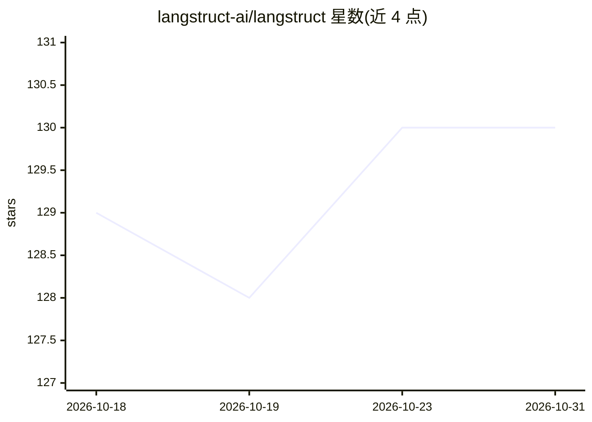

# langstruct-ai/langstruct

⭐ 130 · Python · MIT · 推送 2025-12-01 · [GitHub](https://github.com/langstruct-ai/langstruct) · [官网](https://langstruct.dev) · 组织维护

**面向开发者的 LLM 结构化数据抽取库，自动优化提示词**

基于 DSPy 的 Python 库，从非结构化文本（发票、医疗记录、合同、财报等）抽取类型安全的 JSON：通过示例或 Pydantic schema 定义目标结构，使用 MIPROv2 或 GEPA 优化器自动调优提示词。支持任意 LLM 提供商（OpenAI、Claude、Gemini、本地 Ollama），提供字符级来源溯源、置信度分数、Best-of-N 精炼模式、批量处理与 RAG 双向集成（文档元数据抽取与查询解析为过滤条件）。限制：不适用于实时场景、复杂合并单元格表格及格式关键的文档。

## 筛选速览

| 维度 | 判定 | 备注 |
|---|---|---|
| AI 角色 | `ai-ecosystem` | LLM/agent 周边工具 |
| 许可风险 | `permissive` | MIT |
| 部署形态 | `library` | 以包/库形式分发 |
| 模型依赖 | local-ok | 支持本地模型 |
| 硬件要求 | — | 无带数字的原话,不猜 |
| 安装摩擦 | `low` | 无编译、无系统依赖或容器化 |
| 成熟度 | — | 结构信号不足 |

## 能力要点

- DSPy 自动优化提示词（MIPROv2/GEPA 两种策略）
- 示例或 Pydantic schema 定义结构，输出带校验的类型安全 JSON
- 字符级来源溯源、置信度分数与 refine 精炼模式（官方称准确率提升 15-30%）
- RAG 双向支持：文档元数据抽取 + 用户查询解析为过滤条件

## 适用场景

- 从发票、医疗记录、合同中批量抽取指定字段
- 为 RAG 系统抽取文档元数据并把用户查询解析为检索过滤器
- 构建带来源溯源与审计追踪的引用系统

## 场景标签

`文档解析` · 领域:知识与检索

## 证据(README 行号)

> L8: **Extract structured data from any text – automatically optimized for any LLM**
> L23: - **Auto-optimizes prompts** – DSPy optimizers (MIPROv2, GEPA) do the tuning for you, learns from your examples
> L27: - **Works with any LLM** – OpenAI, Claude, Gemini, or local models. Switch providers without rewriting code.

## 星数曲线

2026-10-18 129 → 2026-10-31 130（+1）

---
*卡片 v1 · prompt 1.4 · 生成 2026-10-23 · 置信度 high · 依据 README sha `825a6092e915` · [字段定义](../../DATASET.md)*
