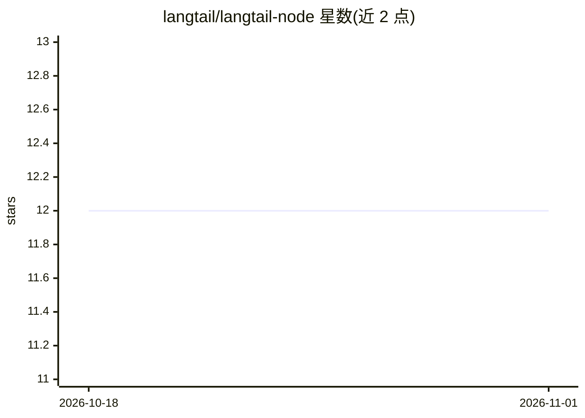

# langtail/langtail-node

⭐ 12 · TypeScript · MIT · 推送 2026-10-27 · [GitHub](https://github.com/langtail/langtail-node) · [官网](https://langtail.com) · 组织维护

**Langtail 平台的 TypeScript SDK：调用已部署 prompt 与日志记录**

Langtail（LLMOps 平台）的官方 TypeScript SDK。通过 createOpenAIProxy 封装 OpenAI API 并附加 Langtail 日志参数；可调用部署到指定环境的 prompt（lt.prompts.invoke），支持流式响应与类型覆盖（npx langtail generate-types）。提供 proxyless 模式：本地渲染 prompt 模板生成 OpenAI 兼容请求体后直连提供商，避免敏感变量暴露。另支持 Vercel AI SDK 集成、工具生成与 JSON 流辅助函数。

## 筛选速览

| 维度 | 判定 | 备注 |
|---|---|---|
| AI 角色 | `ai-ecosystem` | LLM/agent 周边工具 |
| 许可风险 | `permissive` | MIT |
| 部署形态 | `library` | 以包/库形式分发 |
| 模型依赖 | — | README 未给出锁定关系 |
| 硬件要求 | — | 无带数字的原话,不猜 |
| 安装摩擦 | `low` | 无编译、无系统依赖或容器化 |
| 成熟度 | — | 结构信号不足 |

## 能力要点

- createOpenAIProxy 封装 OpenAI API 并附加 Langtail 日志参数
- 调用已部署 prompt，支持 stream: true 流式响应
- proxyless 模式本地渲染模板生成 OpenAI 兼容请求体直连提供商
- Vercel AI SDK 集成与 generate-types / generate-tools 命令

## 适用场景

- 在 TypeScript 项目中调用 Langtail 平台上已部署的 prompt
- 不经过 Langtail API、本地渲染模板后直连 OpenAI
- 配合 Vercel AI SDK 使用 Langtail 的 prompt 与工具

## 场景标签

`提示工程` `LLM 可观测性` · 领域:Agent 开发

## 证据(README 行号)

> L19: basic completion without any prompt. This just wraps openAI api and adds a few extra parameters you can use to affe
> L30: Completion from a deployed prompt can be called with `lt.prompts.invoke`:
> L137: You can use Langtail with Vercel AI SDK.

## 星数曲线

2026-10-18 12 → 2026-11-01 12（+0）

---
*卡片 v1 · prompt 1.4 · 生成 2026-11-01 · 置信度 high · 依据 README sha `182681398f68` · [字段定义](../../DATASET.md)*
