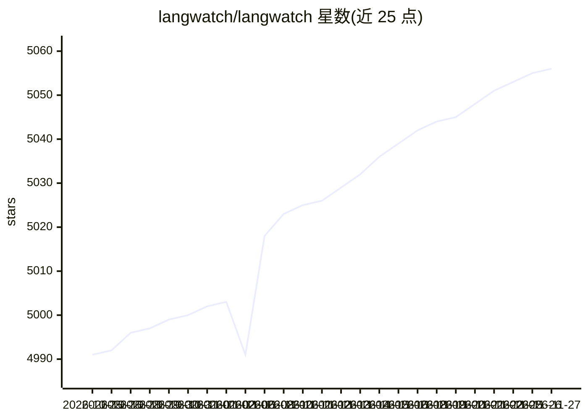

# langwatch/langwatch

⭐ 5,056 · TypeScript · Apache-2.0 · 推送 2026-11-26 · [GitHub](https://github.com/langwatch/langwatch) · [官网](https://langwatch.ai) · 组织维护

**AI 平台团队的 Agent 观测与评测开源平台**

LangWatch 是面向 AI 平台团队的开源 LLM/Agent 运维平台，覆盖四个模块：LLM Ops（观测、Agent 测试、评测、Prompt 管理）、Coding Agents（会话、按 PR 与团队的成本统计、隐私控制）、AI Gateway（OpenAI/Anthropic 兼容端点、虚拟密钥、预算、路由）与 AI Governance（公司内 AI 工具使用统计与异常规则）。提供 Cloud 与自托管两种方式，自托管仅需 Node.js 24+。核心 Apache 2.0，enterprise 目录模块生产使用需商业许可。

## 筛选速览

| 维度 | 判定 | 备注 |
|---|---|---|
| AI 角色 | `ai-ecosystem` | LLM/agent 周边工具 |
| 许可风险 | `permissive` | Apache-2.0 |
| 部署形态 | `library` | 以包/库形式分发 |
| 模型依赖 | — | README 未给出锁定关系 |
| 硬件要求 | — | 无带数字的原话,不猜 |
| 安装摩擦 | `low` | 无编译、无系统依赖或容器化 |
| 成熟度 | — | 结构信号不足 |

## 能力要点

- 四大模块：LLM Ops、Coding Agents、AI Gateway、AI Governance
- AI Gateway 提供一个 OpenAI/Anthropic 兼容端点与虚拟密钥、预算、路由
- 集成多种编码助手（Claude Code、Codex、Copilot 等）与框架（LangChain、DSPy 等）
- 自托管仅需 Node.js 24+（macOS 或 glibc Linux）

## 适用场景

- 跟踪公司内编码助手的会话、成本与隐私控制
- 为 Agent 和语音 Agent 创建仿真测试做评测基准
- 用带预算的虚拟密钥分发给客户或员工
- 审计公司内各 AI 工具的使用情况并配置异常规则

## 场景标签

`LLM 可观测性` `模型评测` `模型网关` `提示工程` · 领域:Agent 开发

## 证据(README 行号)

> L9: LangWatch is the open-source platform for AI in production: trace, test, route and govern every LLM call in your com
> L39: - **LLM Ops**: Observability · Agent Testing · Evaluations · Prompt Management
> L41: - **AI Gateway**: one OpenAI and Anthropic compatible endpoint, virtual keys, budgets, routing

## 星数曲线

2026-10-25 4,991 → 2026-11-27 5,056（+65）

---
*卡片 v1 · prompt 1.4 · 生成 2026-11-22 · 置信度 high · 依据 README sha `c43add493358` · [字段定义](../../DATASET.md)*
