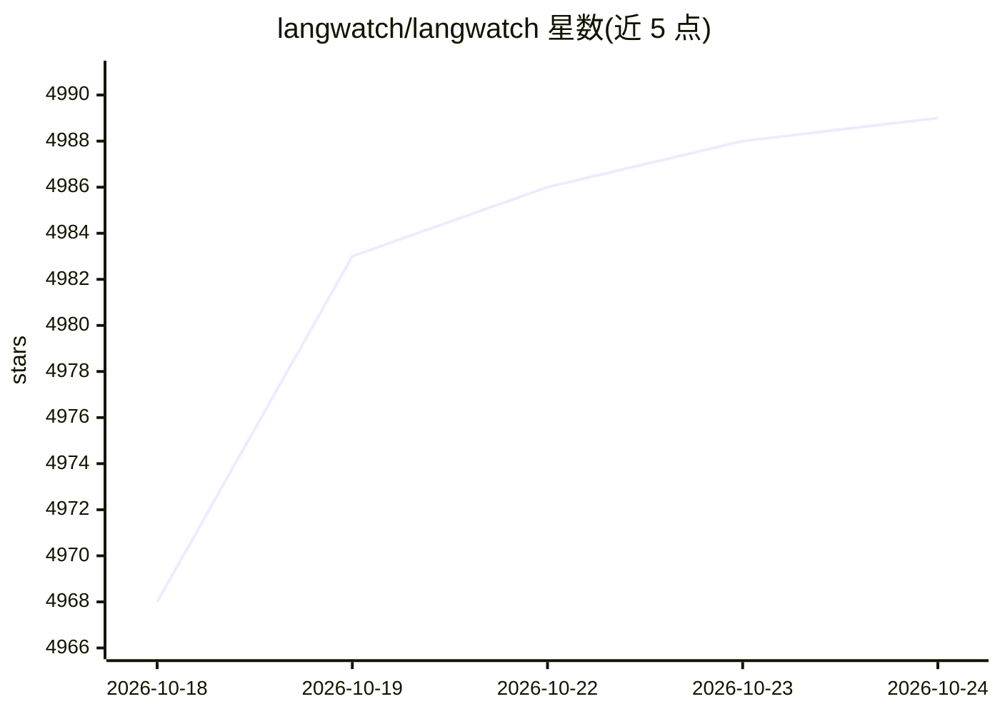

# langwatch/langwatch

⭐ 4,989 · TypeScript · Apache-2.0 · 推送 2026-10-23 · [GitHub](https://github.com/langwatch/langwatch) · [官网](https://langwatch.ai) · 组织维护

**面向 AI 平台团队的开源 Agent 可观测与评测平台**

LangWatch 是开源的 LLM 生产平台（open-core，Apache 2.0 核心加企业扩展），功能覆盖四块：LLM Ops（追踪、Agent 测试、评测、Prompt 管理）、Coding Agents（会话与每 PR/团队成本、隐私控制）、AI Gateway（OpenAI/Anthropic 兼容端点、虚拟密钥、预算与路由）、AI Governance（公司内 AI 工具使用审计与异常规则）。支持 LangChain、DSPy、OpenTelemetry 等框架集成；可通过 npx 追踪 Claude Code/Codex/Copilot 等编码助手，或仅依赖 Node.js 自托管；企业模块生产环境需商业许可。

## 筛选速览

| 维度 | 判定 | 备注 |
|---|---|---|
| AI 角色 | `ai-ecosystem` | LLM/agent 周边工具 |
| 许可风险 | `permissive` | Apache-2.0 |
| 部署形态 | `library` | 以包/库形式分发 |
| 模型依赖 | — | README 未给出锁定关系 |
| 硬件要求 | — | 无带数字的原话,不猜 |
| 安装摩擦 | `low` | 无编译、无系统依赖或容器化 |
| 成熟度 | — | 结构信号不足 |

## 能力要点

- Agent 追踪、模拟测试与评测
- AI Gateway：OpenAI/Anthropic 兼容端点、虚拟密钥、预算与路由
- 编码助手会话与每 PR/团队成本统计
- 公司级 AI 工具使用治理与异常规则

## 适用场景

- 为自建 agent 与编码助手接入统一的追踪与评测
- 用虚拟密钥和预算管控员工或客户的模型调用
- 统计每 PR AI 成本并审计公司内 AI 工具使用情况

## 场景标签

`LLM 可观测性` `模型评测` `模型网关` `提示工程` · 领域:Agent 开发

## 证据(README 行号)

> L7:  LangWatch: Agent Observability &amp; Evals for AI Platform teams
> L39: - **LLM Ops**: Observability · Agent Testing · Evaluations · Prompt Management
> L41: - **AI Gateway**: one OpenAI and Anthropic compatible endpoint, virtual keys, budgets, routing

## 星数曲线

2026-10-18 4,968 → 2026-10-24 4,989（+21）

---
*卡片 v1 · prompt 1.4 · 生成 2026-10-20 · 置信度 high · 依据 README sha `bce9c79bd169` · [字段定义](../../DATASET.md)*
