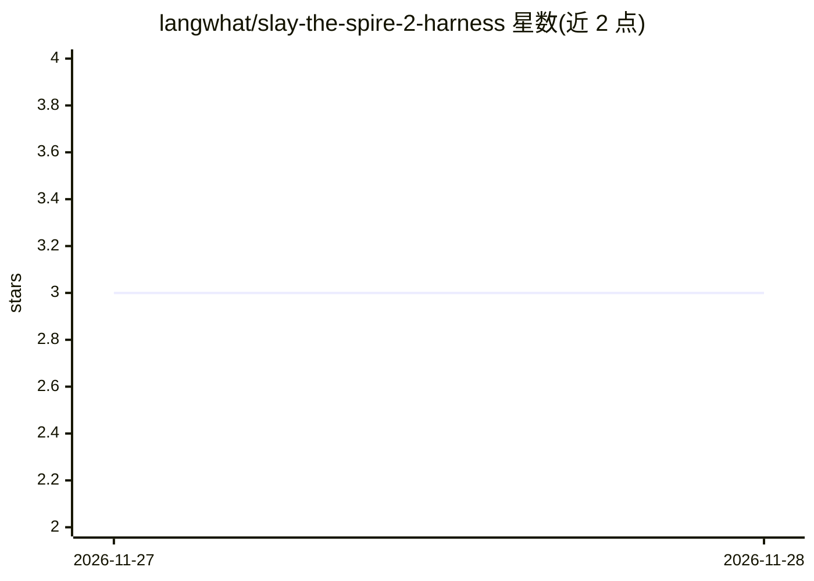

# langwhat/slay-the-spire-2-harness

⭐ 3 · Python · MIT · 推送 2026-11-27 · [GitHub](https://github.com/langwhat/slay-the-spire-2-harness) · 个人维护 · 中文 README

**用 LLM agent 打杀戮尖塔 2 的 harness，含录像与离线回放**

通过游戏 Mod（sts2agent）经本地 HTTP 暴露游戏公开状态与动作，Python 后端按三个模型角色分工决策：Run 规划路线/商店/事件，Deck 选牌，Combat 打每场战斗。内置驱动记录游戏与模型交换数据供离线回放，外部驱动仅写诊断；支持替换为固定代码策略，或通过本地工具 API 用外部 agent 驱动游戏。要求 Python 3.12+、uv、Steam public-beta 分支游戏本体与 .NET 9 SDK 构建 Mod；开发者 headless 运行仅限 macOS。

## 筛选速览

| 维度 | 判定 | 备注 |
|---|---|---|
| AI 角色 | `ai-native` | 本体是模型或模型工具 |
| 许可风险 | `permissive` | MIT |
| 部署形态 | `None` |  |
| 模型依赖 | — | README 未给出锁定关系 |
| 硬件要求 | — | 无带数字的原话,不猜 |
| 安装摩擦 | `medium` | 含编译或系统依赖之一 |
| 成熟度 | — | 结构信号不足 |

## 能力要点

- 三个模型角色分工决策：Run 规划、Deck 选牌、Combat 战斗
- Mod 经本地 HTTP 暴露游戏状态与动作
- 每局写入 archive.sqlite，支持离线回放与冻结决策评估
- 可插入自定义固定代码策略或经工具 API 由外部 agent 驱动

## 适用场景

- 让 LLM agent 完整游玩一局杀戮尖塔 2
- 回放并审查历史对局的模型决策记录
- 用外部 agent 通过工具 API 接管游戏操作

## 场景标签

`Agent 框架` · 领域:Agent 开发

## 证据(README 行号)

> L5: A model-driven player for Slay the Spire 2 that plays one run at a time without save/load.
> L7: - **Mod.** The `sts2agent` game Mod exposes the game's public state and actions over local HTTP.
> L22: - A model endpoint using the OpenAI Responses, Chat Completions, or Anthropic Messages

## 星数曲线

2026-11-27 3 → 2026-11-28 3（+0）

---
*卡片 v1 · prompt 1.4 · 生成 2026-11-27 · 置信度 high · 依据 README sha `e5c2fad264c8` · [字段定义](../../DATASET.md)*
