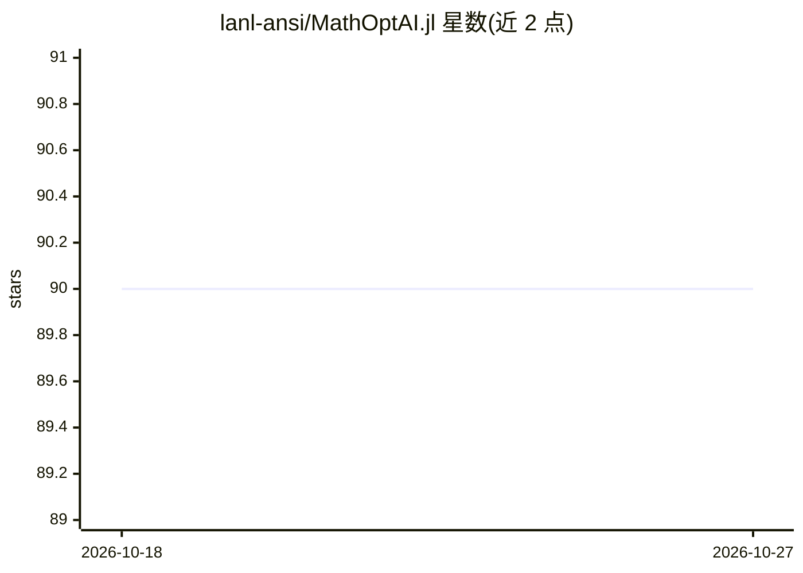

# lanl-ansi/MathOptAI.jl

⭐ 90 · Julia · NOASSERTION · 推送 2026-08-27 · [GitHub](https://github.com/lanl-ansi/MathOptAI.jl) · [官网](https://lanl-ansi.github.io/MathOptAI.jl/) · 组织维护

**把训练好的 ML 预测器嵌入 JuMP/ExaModels 优化模型的 Julia 库**

Julia 包，将已训练的 AI/机器学习/统计学习预测器嵌入 JuMP 与 ExaModels 优化模型：以 JuMP 变量作为预测器输入，输出为表示输出层的 JuMP 变量，并自动添加所需额外变量与约束。面向使用 Julia 做优化的开发与科研用户，典型如决策优化中直接调用神经网络代理模型。项目灵感来自 OMLT 与 gurobi-machinelearning，另列出 JANOS、MeLOn 等相关工作；BSD-3 许可，由 Los Alamos 国家实验室团队维护。

## 筛选速览

| 维度 | 判定 | 备注 |
|---|---|---|
| AI 角色 | `ai-ecosystem` | LLM/agent 周边工具 |
| 许可风险 | `none` | NOASSERTION |
| 部署形态 | `None` |  |
| 模型依赖 | — | README 未给出锁定关系 |
| 硬件要求 | — | 无带数字的原话,不猜 |
| 安装摩擦 | `low` | 无编译、无系统依赖或容器化 |
| 成熟度 | — | 结构信号不足 |

## 能力要点

- 把训练好的预测器（如 Flux 神经网络）嵌入 JuMP/ExaModels 模型
- 预测器输入输出映射为 JuMP 变量并自动生成变量与约束
- BSD-3 许可，提供学术引用条目

## 适用场景

- 在优化/决策模型中直接使用训练好的神经网络作为代理约束或目标
- 把机器学习预测与数学规划求解结合的科研工作
- 复现或扩展 OMLT、gurobi-machinelearning 类工作流的 Julia 替代路径

## 场景标签

 · 领域:数学优化/机器学习

## 证据(README 行号)

> L6: MathOptAI.jl is a package for embedding trained AI, machine learning, and
> L7: statistical learning models into JuMP and ExaModels.

## 星数曲线

2026-10-18 90 → 2026-10-27 90（+0）

---
*卡片 v1 · prompt 1.4 · 生成 2026-10-23 · 置信度 high · 依据 README sha `e3c70e753c0c` · [字段定义](../../DATASET.md)*
