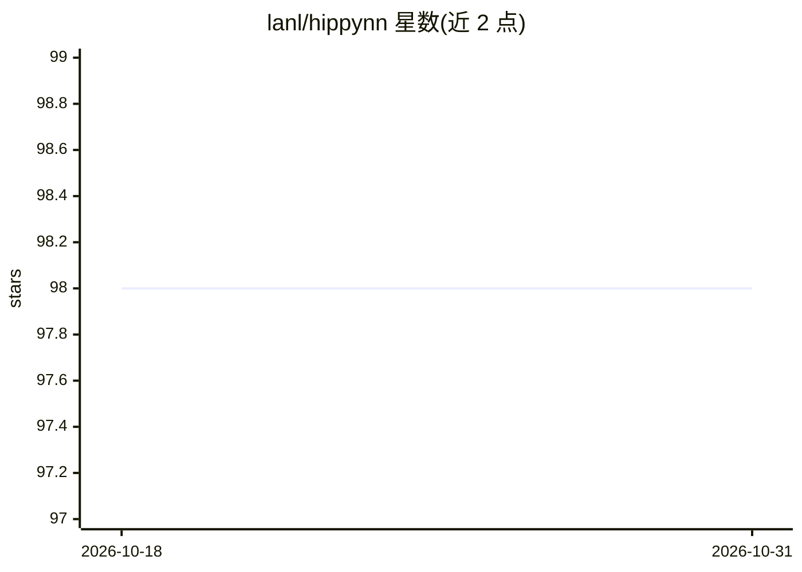

# lanl/hippynn

⭐ 98 · Python · NOASSERTION · 推送 2026-08-22 · [GitHub](https://github.com/lanl/hippynn) · [官网](https://lanl.github.io/hippynn/) · 组织维护

**基于 PyTorch 的原子体系机器学习库，训练分子/材料模型**

面向原子（或物理点云）机器学习的 Python 模块化库，围绕 HIP-NN 架构开发但支持其他模型扩展。提供原子操作的 PyTorch 层（能量、力、电荷等）、图级 API 从 PyTorch 组件构建模型、绘图级 API 追踪训练、训练与实验 API（回调、检查点），以及 numba/cupy 自定义核（CPU 与 GPU）。支持 ASE calculator、PYSEQM 节点和经 MLIAP Unified 接口在 LAMMPS 中使用模型。基础安装仅需 pytorch 与 numpy，推荐源码安装，开发中可能出现破坏性变更。BSD-3 许可，版权归 Triad/LANL。

## 筛选速览

| 维度 | 判定 | 备注 |
|---|---|---|
| AI 角色 | `ai-native` | 本体是模型或模型工具 |
| 许可风险 | `none` | NOASSERTION |
| 部署形态 | `library` | 以包/库形式分发 |
| 模型依赖 | — | README 未给出锁定关系 |
| 硬件要求 | — | 无带数字的原话,不猜 |
| 安装摩擦 | `low` | 无编译、无系统依赖或容器化 |
| 成熟度 | `idea` | |

## 能力要点

- 原子操作的模块化 PyTorch 层（能量/力/电荷/键级），支持线性标度模型
- 图级 API 按问题物理/数学抽象构建模型，节点支持原生 Python 语法
- numba/cupy 自定义核，CPU 与 GPU 执行，接入 PyTorch Autograd
- ASE / PYSEQM / LAMMPS（MLIAP Unified）接口

## 适用场景

- 训练原子体系机器学习模型（能量、力、电荷等性质预测）
- 在 ASE 或 LAMMPS 模拟中使用训练好的模型
- 基于 HIP-NN 或自定义架构做分子/材料科学研究

## 场景标签

`模型训练` · 领域:训练与推理

## 证据(README 行号)

> L1: The hippynn python package - a modular library for atomistic machine learning with pytorch.
> L14: Modular set of pytorch layers for atomistic operations
> L17: - Model energy, force charge & charge moments, bond orders, and more!

## 星数曲线

2026-10-18 98 → 2026-10-31 98（+0）

---
*卡片 v1 · prompt 1.4 · 生成 2026-10-23 · 置信度 high · 依据 README sha `d3fc4e77fd01` · [字段定义](../../DATASET.md)*
