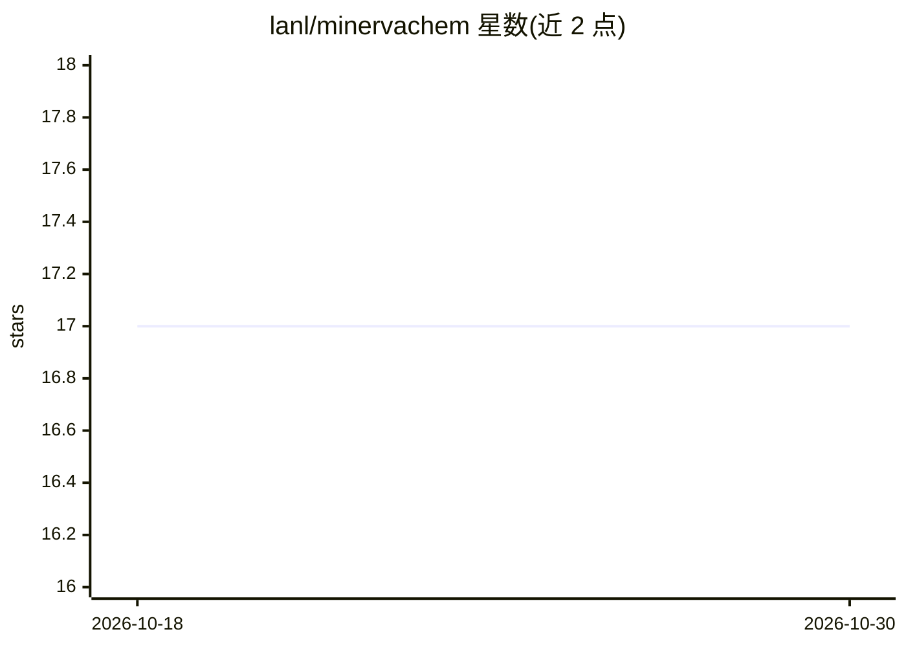

# lanl/minervachem

⭐ 17 · Python · NOASSERTION · 推送 2026-04-27 · [GitHub](https://github.com/lanl/minervachem) · 组织维护

**化学信息学与机器学习库：分子 graphlet 指纹与可解释建模**

Python 库，实现 Graphlet 指纹等化学信息学工具：Fingerprinter 类从分子生成 graphlet 指纹，提供 scikit-learn 风格 transformer 构建特征矩阵，并用 HierarchicalResidualModel 拟合可解释线性模型（论文中模型含 >100,000 系数），支持通过 GraphletDAG 投影方法可视化原子/键级贡献。面向化学信息学与化学机器学习研究者。当前为 alpha 版本，可能存在破坏性变更；推荐 conda 环境安装，pip 安装方式标注为不推荐。BSD-3 许可，版权属 Triad National Security, LLC（LANL）。

## 筛选速览

| 维度 | 判定 | 备注 |
|---|---|---|
| AI 角色 | `ai-native` | 本体是模型或模型工具 |
| 许可风险 | `none` | NOASSERTION |
| 部署形态 | `library` | 以包/库形式分发 |
| 模型依赖 | — | README 未给出锁定关系 |
| 硬件要求 | — | 无带数字的原话,不猜 |
| 安装摩擦 | `low` | 无编译、无系统依赖或容器化 |
| 成熟度 | `idea` | |

## 能力要点

- GraphletFingerprinter 生成分子 graphlet 指纹
- scikit-learn 风格 transformer 构建分子特征矩阵
- HierarchicalResidualModel 拟合可解释层级线性模型
- GraphletDAG 投影可视化原子/键级预测贡献

## 适用场景

- 为分子数据集生成 graphlet 指纹特征
- 在 QM9 等数据上拟合可解释的化学性质预测模型
- 可视化模型预测中各原子/化学键的贡献

## 场景标签

 · 领域:化学信息学/科学计算

## 证据(README 行号)

> L1: # MinervaChem - a python library for cheminformatics and machine learning
> L3: Minervachem implements Graphlet Fingerprints and other utilities cheminformatics and chemical machine learning.
> L43: `Fingerprinter` classes provide reusable objects for generating molecular fingerprints, including the graphlet fing

## 星数曲线

2026-10-18 17 → 2026-10-30 17（+0）

---
*卡片 v1 · prompt 1.4 · 生成 2026-10-29 · 置信度 high · 依据 README sha `50da05d9161d` · [字段定义](../../DATASET.md)*
