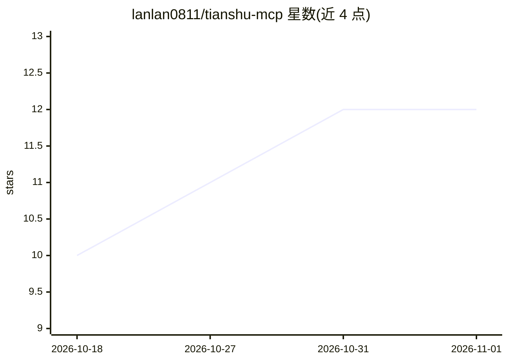

# lanlan0811/tianshu-mcp

⭐ 12 · TypeScript · Apache-2.0 · 推送 2026-10-31 · [GitHub](https://github.com/lanlan0811/tianshu-mcp) · [官网](https://lanaiw.top) · 个人维护 · 中文 README

**编排外部 AI-Agent 干活并用运行时证据验收的 MCP server**

tianshu-mcp 是被天枢（Tianshu）当作标准 MCP server 接入的编排层，面向把开发任务交给 AI-Agent 的用户，回答「Agent 说做完了，谁来证明」。它承担三部分：调度（队列/并发闸/状态机/取消）、执行面（把任务书投递给外部桌面 Agent，经 CDP 驱动 UI，或 CLI 子进程）、客观验收仪（相对 git 基线做命令检查、代码分析与可选视觉比对，fail-closed 拦假绿）。验收不合格自动生成结构化修复指令并返修，轮次耗尽转人工裁决。提供 8 个 MCP 工具，支持 Codex 桌面端、ZCode、TRAE SOLO CN、Kimi Code、Qoder CN、Open Design 等六个 GUI 执行面；不保存/转发任何 API key。经 npx/npm 或源码构建安装，需 Node.js ≥ 20。

## 筛选速览

| 维度 | 判定 | 备注 |
|---|---|---|
| AI 角色 | `ai-ecosystem` | LLM/agent 周边工具 |
| 许可风险 | `permissive` | Apache-2.0 |
| 部署形态 | `library` | 以包/库形式分发 |
| 模型依赖 | — | README 未给出锁定关系 |
| 硬件要求 | — | 无带数字的原话,不猜 |
| 安装摩擦 | `low` | 无编译、无系统依赖或容器化 |
| 成熟度 | — | 结构信号不足 |

## 能力要点

- 8 个 MCP 工具：run_task 秒回 taskId，wait_task 阻塞等到停点
- 相对 git 基线的客观验收，三项 fail-closed 保护拦截「假绿」
- 失败自动解析为可执行修复动作并返修闭环，轮次耗尽转人工裁决
- 六个 GUI 执行面（CDP 驱动），新 agent = 一个 profile 即可扩展

## 适用场景

- 通过天枢调用 Codex/ZCode 等桌面 Agent 完成开发任务并自动验收
- 对 Agent 产出的代码用命令检查与代码分析做客观核验
- 验收不通过时自动返修，失败原因结构化喂回 agent

## 场景标签

`Agent 框架` `代码审查` · 领域:Agent 开发

## 证据(README 行号)

> L41: > **tianshu-mcp** 是被 **天枢（Tianshu）** 当作标准 MCP server 接入的编排层。天枢是总指挥与用户交互面，本 server 承担三件事：**调度**（队列 / 并发闸 / 状态机 / 取消）
> L48:         tianshu-mcp              ← 调度 · 执行面 · 验收仪

## 星数曲线

2026-10-18 10 → 2026-11-01 12（+2）

---
*卡片 v1 · prompt 1.4 · 生成 2026-11-01 · 置信度 high · 依据 README sha `1b8b844bb3f6` · [字段定义](../../DATASET.md)*
