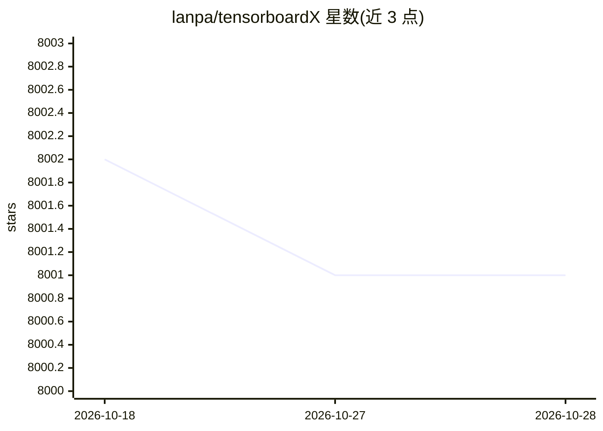

# lanpa/tensorboardX

⭐ 8,001 · Python · MIT · 推送 2026-07-14 · [GitHub](https://github.com/lanpa/tensorboardX) · [官网](https://tensorboardx.readthedocs.io/en/latest/tensorboard.html) · 个人维护

**为 PyTorch 等框架写入 TensorBoard 事件的可视化日志库**

tensorboardX 让 PyTorch、Chainer、MXNet、NumPy 等框架通过简单函数调用写入 TensorBoard 事件文件，覆盖 scalar、image、histogram、audio、graph、embedding、video 等摘要类型，用 TensorBoard 命令即可查看。当前版本 v2.6.5 在 Python 3.10–3.13 上与 PyTorch 2.6、tensorboard 2.19.0 测试。可选安装 crc32c 加速，add_audio 需 soundfile。支持直接记录到 Comet 云端实验跟踪平台。

## 筛选速览

| 维度 | 判定 | 备注 |
|---|---|---|
| AI 角色 | `ai-ecosystem` | LLM/agent 周边工具 |
| 许可风险 | `permissive` | MIT |
| 部署形态 | `library` | 以包/库形式分发 |
| 模型依赖 | — | README 未给出锁定关系 |
| 硬件要求 | — | 无带数字的原话,不猜 |
| 安装摩擦 | `low` | 无编译、无系统依赖或容器化 |
| 成熟度 | — | 结构信号不足 |

## 能力要点

- 支持 scalar/image/histogram/audio/graph/embedding/video 等 12+ 类摘要
- 通过 pip 安装，简单函数调用写入 TensorBoard 事件
- 可直接记录到 Comet 云端实验跟踪平台
- 与 PyTorch 2.6 / Python 3.10–3.13 组合测试

## 适用场景

- 在 PyTorch 训练中记录损失曲线、图像与直方图并可视化
- 为 Chainer/MXNet/NumPy 项目生成 TensorBoard 可读日志
- 将实验记录同步到 Comet 进行对比管理

## 场景标签

`MLOps` · 领域:训练与推理

## 证据(README 行号)

> L7: Write TensorBoard events with simple function call.
> L9: The current release (v2.6.5) is tested with PyTorch 2.6 / torchvision 0.21.0 / tensorboard 2.19.0 on Python 3.10 to 

## 星数曲线

2026-10-18 8,002 → 2026-10-28 8,001（-1）

---
*卡片 v1 · prompt 1.4 · 生成 2026-10-20 · 置信度 high · 依据 README sha `ae38923f14eb` · [字段定义](../../DATASET.md)*
