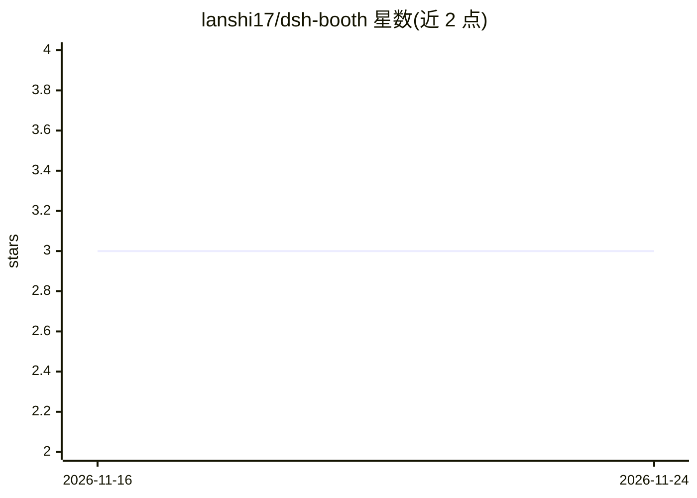

# lanshi17/dsh-booth

⭐ 3 · Rust · GPL-3.0 · 推送 2026-11-23 · [GitHub](https://github.com/lanshi17/dsh-booth) · 个人维护 · 中文 README

**dsh agent 团队的终端控制台：提交工单、监督执行、命令面板操作**

booth 是面向 dsh-superagent 团队的独立终端控制台与组件监督器，用 Rust 编写。它提供 TUI 界面、会话历史、命令面板与进程生命周期管理，对话由团队的 portal agent 与委派 worker 处理。booth 通过回环管理 API 与 agent 通信，组件通过租约机制注册到端口 3081 的监督进程，booth restart 只替换该组件。支持会话保存恢复、WeChat/飞书消息接入、OSC 52 剪贴板复制。后端需已认证的 GitHub CLI 与可推送仓库。预装安装器支持 Linux x86_64/ARM64，也可从源码构建。

## 筛选速览

| 维度 | 判定 | 备注 |
|---|---|---|
| AI 角色 | `ai-ecosystem` | LLM/agent 周边工具 |
| 许可风险 | `viral` | GPL-3.0 |
| 部署形态 | `library` | 以包/库形式分发 |
| 模型依赖 | — | README 未给出锁定关系 |
| 硬件要求 | — | 无带数字的原话,不猜 |
| 安装摩擦 | `medium` | 含编译或系统依赖之一 |
| 成熟度 | — | 结构信号不足 |

## 能力要点

- 组件租约注册与心跳续约机制，booth restart 仅替换单个组件
- 会话保存于 jsonl 文件，/sessions 列出、/session 恢复
- WeChat iLink 扫码登录与飞书自建应用接入，凭据以 0600 权限保存
- OSC 52 剪贴板复制，ssh/tmux 下复制到本地终端

## 适用场景

- 在终端里向运行中的 dsh agent 提交任务并观察执行状态
- 通过微信或飞书向 agent 发送指令
- 管理 agent 服务的启动、重启与组件健康检查

## 场景标签

`AI 助手` · 领域:对话与助手

## 证据(README 行号)

> L3: `booth` is an independent terminal console and component supervisor for the
> L18: The console talks to the bundle's loopback management API (`/orchestrator/api/*`). The booth
> L47: the DSH model provider and its credentials for the team. Until setup succeeds, booth shows the

## 星数曲线

2026-11-16 3 → 2026-11-24 3（+0）

---
*卡片 v1 · prompt 1.4 · 生成 2026-11-22 · 置信度 mid · 依据 README sha `ba0fdadf20c3` · [字段定义](../../DATASET.md)*
