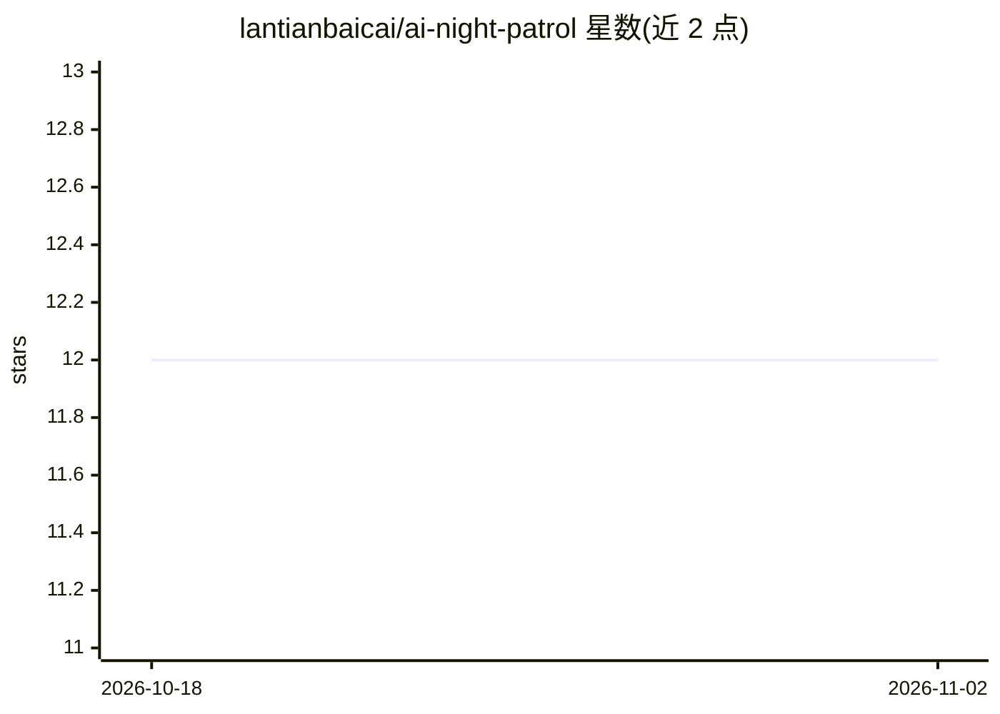

# lantianbaicai/ai-night-patrol

⭐ 12 · Python · 推送 2026-08-23 · [GitHub](https://github.com/lantianbaicai/ai-night-patrol) · [官网](https://lantianbaicai.github.io/ai-night-patrol/) · 个人维护 · 中文 README

**独立开发者的可信机会情报与决策代理工作流**

一套持续运行的机会研究工作流：从 GitHub、36氪、Hacker News 等来源采集候选信号，保留商业可行性评分，补充一手来源、重复次数与证据边界，并映射到可构建项目与求职作品证据。V4 新增个人机会决策层：基于 opportunity_profile 生成资产复用、能力匹配、渠道触达、证据成熟四项可解释评分，判断进入 7/30 天复核队列，结果写入 decision_outcomes.json，初始为空不填充模拟数据。公开版含 111 份去重报告，提供静态仪表盘（四视图）、单元测试与发布安全检查（凭据环境变量读取、明文 Token 扫描、原子提交校验）。本地以 Python 脚本构建数据并经 http.server 提供仪表盘。

## 筛选速览

| 维度 | 判定 | 备注 |
|---|---|---|
| AI 角色 | `ai-native` | 本体是模型或模型工具 |
| 许可风险 | `none` | — |
| 部署形态 | `None` |  |
| 模型依赖 | — | README 未给出锁定关系 |
| 硬件要求 | — | 无带数字的原话,不猜 |
| 安装摩擦 | `low` | 无编译、无系统依赖或容器化 |
| 成熟度 | — | 结构信号不足 |

## 能力要点

- 多来源信号采集与证据边界标注，热度、证据、决策分开呈现
- V4 个人决策层：四项可解释评分 + 7/30 天复核队列，支持推翻原判断
- 发布安全机制：GITHUB_TOKEN 环境变量、明文凭据扫描、原子提交与远端 SHA 校验
- 静态 V3 仪表盘含机会情报、求职证据、运行健康、验证账本四视图

## 适用场景

- 独立开发者筛选值得投入的产品方向并跟踪判断复核
- 把机会信号对应到作品集与岗位证据的缺口分析
- 以仪表盘审计自动报告的质量门与凭据健康状态

## 场景标签

`工作流自动化` `网页抓取` · 领域:效率与自动化

## 证据(README 行号)

> L3: AI 夜巡不是“每日热点搬运”，而是一套持续运行的机会研究工作流：
> L71: - 每条最新机会都会生成资产复用、能力匹配、渠道触达、证据成熟四项可解释评分。

## 星数曲线

2026-10-18 12 → 2026-11-02 12（+0）

---
*卡片 v1 · prompt 1.4 · 生成 2026-11-01 · 置信度 mid · 依据 README sha `b879e0e474fb` · [字段定义](../../DATASET.md)*
