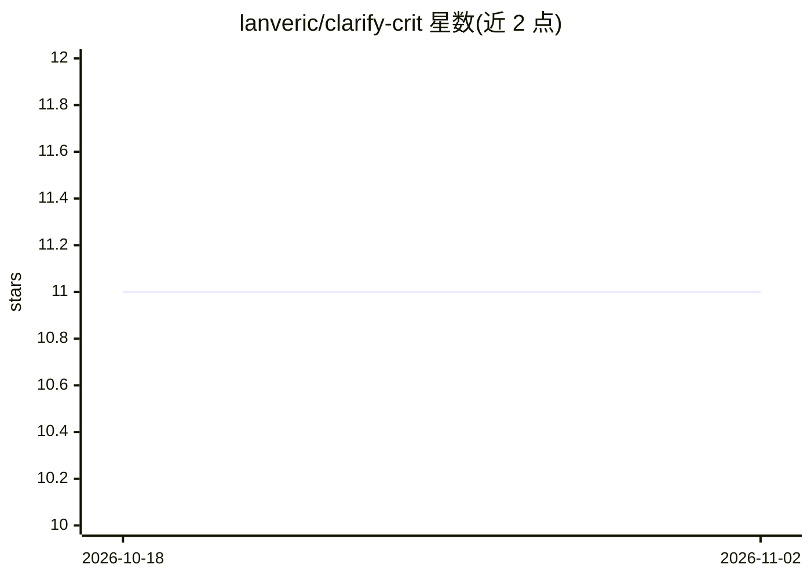

# lanveric/clarify-crit

⭐ 11 · 推送 2026-07-18 · [GitHub](https://github.com/lanveric/clarify-crit) · 个人维护

**面向 Claude 的请求澄清技能包，用最少提问消解歧义**

基于 CRIT 方法（Context/Role/Interview/Task）的 AI 技能包：在模型行动前先理解用户请求，恢复已知信息、只问对结果有实质影响的问题，可直接回答或输出简短便携的任务简报，避免长表单式的需求发现。以可分发的技能目录形式提供，可上传至 Claude.ai 技能上传器或下载预构建的 release zip；仓库另含测试与回归资产（不随运行时分发）。MIT 许可。

## 筛选速览

| 维度 | 判定 | 备注 |
|---|---|---|
| AI 角色 | `ai-ecosystem` | LLM/agent 周边工具 |
| 许可风险 | `none` | — |
| 部署形态 | `None` |  |
| 模型依赖 | locked-api |  |
| 硬件要求 | — | 无带数字的原话,不猜 |
| 安装摩擦 | `low` | 无编译、无系统依赖或容器化 |
| 成熟度 | — | 结构信号不足 |

## 能力要点

- CRIT 四要素方法（Context, Role, Interview, Task）驱动的请求精炼
- 最少提问与最少交互成本原则
- 可上传 Claude.ai 技能上传器的独立技能包目录

## 适用场景

- 让 Claude 类 agent 在执行前澄清模糊请求
- 减少需求发现环节的冗长问答
- 将口头需求整理为可移植的任务简报

## 场景标签

`提示工程` · 领域:Agent 开发

## 证据(README 行号)

> L3: **Clarify** is a lightweight request-refinement skill for AI models, built on the **CRIT** method (Context, Role, In
> L13: - `clarify-crit/` — the distributable skill package. This folder alone is what gets uploaded to the Claude.ai skill

## 星数曲线

2026-10-18 11 → 2026-11-02 11（+0）

---
*卡片 v1 · prompt 1.4 · 生成 2026-11-02 · 置信度 mid · 依据 README sha `a738c406c641` · [字段定义](../../DATASET.md)*
