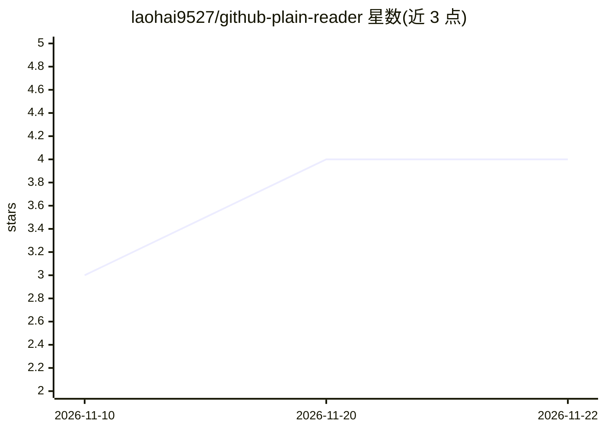

# laohai9527/github-plain-reader

⭐ 4 · JavaScript · 推送 2026-11-03 · [GitHub](https://github.com/laohai9527/github-plain-reader) · 个人维护 · 中文 README

**把 GitHub 仓库翻译成中文大白话解读的 Chrome 扩展**

Chrome/Edge 扩展（Manifest V3）：抓取 GitHub 仓库的星标、更新频率、许可证、文件结构与 README 等客观数据，交给 AI 生成固定六段的中文大白话报告（一句话比喻、体检表、痛点、上手步骤、坑、术语解释），最后给出推荐结论。用户需自填 AI 接口 Key，默认 DeepSeek，也支持任意 OpenAI 格式兼容接口。报告支持追问对话、导出 PDF/Markdown/网页，以及转交给桌面或网页版 AI 应用继续处理。通过加载解压文件夹安装，暂未指定开源许可证。

## 筛选速览

| 维度 | 判定 | 备注 |
|---|---|---|
| AI 角色 | `ai-native` | 本体是模型或模型工具 |
| 许可风险 | `none` | — |
| 部署形态 | `None` |  |
| 模型依赖 | locked-api |  |
| 硬件要求 | — | 无带数字的原话,不猜 |
| 安装摩擦 | `low` | 无编译、无系统依赖或容器化 |
| 成熟度 | — | 结构信号不足 |

## 能力要点

- 抓取仓库客观数据后生成固定六段结构的中文大白话报告
- 支持任何 OpenAI 格式兼容接口，Key 只存本机浏览器存储
- 报告可追问对话，并可转交给多个桌面/网页 AI 应用接续
- 报告分段并行生成，每段独立重试；可导出 PDF/Markdown/单文件网页

## 适用场景

- 不用懂英文和代码也能看懂 GitHub 项目是干嘛的
- 评估一个开源项目靠不靠谱、有哪些坑再决定用不用
- 把仓库解读结果转交给其他 AI 工具继续深入分析

## 场景标签

`文档问答` `代码审查` · 领域:编码与开发

## 证据(README 行号)

> L3: 一个 Chrome / Edge 扩展：粘贴一个 GitHub 仓库链接，还你一份**中文大白话说明**——它是干嘛的、靠不靠谱、怎么上手、有哪些坑。
> L11: 这个扩展干的事很简单：把仓库的客观数据（星标、更新频率、许可证、文件结构、README）抓下来，交给 AI 翻译成一段**给外行看的话**，然后按固定结构排出来。
> L44: 一次解读大概几分钱。接口地址默认就是 DeepSeek，也支持任何 OpenAI 格式的兼容接口（填 base url + 模型名即可）。

## 星数曲线

2026-11-10 3 → 2026-11-22 4（+1）

---
*卡片 v1 · prompt 1.4 · 生成 2026-11-21 · 置信度 high · 依据 README sha `ae2e883f37b2` · [字段定义](../../DATASET.md)*
