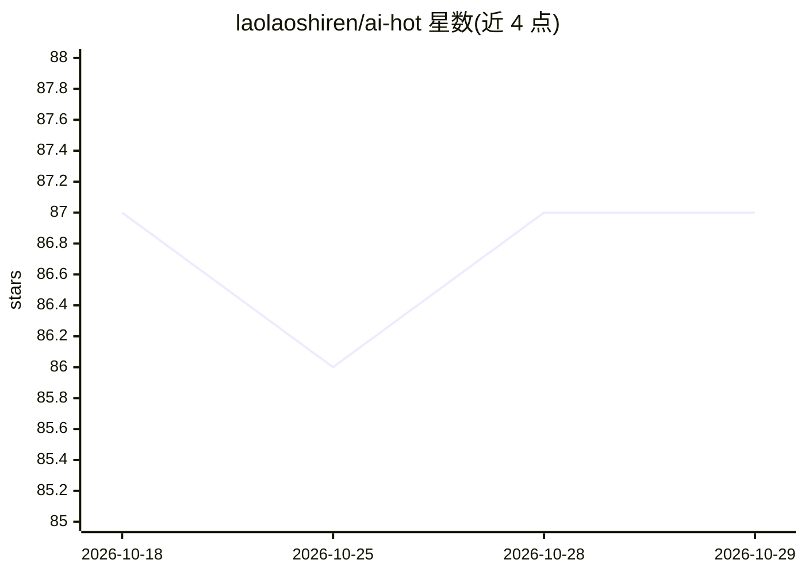

# laolaoshiren/ai-hot

⭐ 87 · Python · MIT · 推送 2026-09-25 · [GitHub](https://github.com/laolaoshiren/ai-hot) · [官网](https://aihot.bt199.com) · 个人维护 · 中文 README

**面向中文用户的 AI 工具/模型/新闻导航站，GitHub 与网站双向同步**

AI 热榜是一个 AI 信息导航站（https://aihot.bt199.com/）的 GitHub 摘要镜像：仓库首页只放热点摘要、AI 简报、今日精选、热度飙升与工具清单，完整内容引导到网站浏览，README 自述每 6 小时自动更新。内容按 AI 工具（175）、AI 模型（407）、AI Agent（77）、AI 新闻（4583）、AI 提供商（59）分类，并提供站内搜索与工具对比。仓库本身承担内容入口而非代码托管，无部署说明。

## 筛选速览

| 维度 | 判定 | 备注 |
|---|---|---|
| AI 角色 | `ai-knowledge` | 知识聚合/清单类 |
| 许可风险 | `permissive` | MIT |
| 部署形态 | `None` |  |
| 模型依赖 | — | README 未给出锁定关系 |
| 硬件要求 | — | 无带数字的原话,不猜 |
| 安装摩擦 | `low` | 无编译、无系统依赖或容器化 |
| 成熟度 | — | 结构信号不足 |

## 能力要点

- AI 工具/模型/Agent/新闻/提供商五大分类导航
- GitHub 首页摘要 + 网站完整版的双向信息流
- 收录今日热点、AI 简报、精选工具与热度飙升榜

## 适用场景

- 查找和对比当前流行的 AI 工具与模型
- 按分类浏览 AI Agent 相关资源
- 跟踪 AI 领域新闻热点与热搜关键词

## 场景标签

`精选清单` · 领域:学习与行业

## 证据(README 行号)

> L108: ## 🌐 这个 README 是干嘛的
> L110: 它不是部署说明书，而是 **https://aihot.bt199.com/ 的 GitHub 简化版**：

## 星数曲线

2026-10-18 87 → 2026-10-29 87（+0）

---
*卡片 v1 · prompt 1.4 · 生成 2026-10-23 · 置信度 high · 依据 README sha `35153b52f0f0` · [字段定义](../../DATASET.md)*
