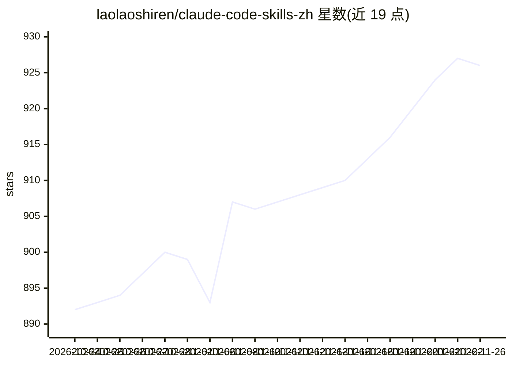

# laolaoshiren/claude-code-skills-zh

⭐ 926 · Python · MIT · 推送 2026-11-25 · [GitHub](https://github.com/laolaoshiren/claude-code-skills-zh) · [官网](https://claude-skills.bt199.com/) · 个人维护 · 中文 README

**给中文开发者的 Claude Code Skills 中文精选清单与原创技能集**

面向中文开发者的 Claude Code Skills / Agents / Plugins 精选仓库：收录 452+ 个按场景分类的第三方技能条目（含公众号、小红书、飞书、企业微信等国内平台分类），每条附中文说明；另含 22 个自研原创中文技能（skill-translator、zh-code-reviewer、zh-readme 等），通过 Claude Code 插件市场命令或 git clone 复制到 ~/.claude/skills 安装，并提供 Codex / Cursor / Gemini CLI / OpenClaw 的技能目录路径对照。MIT 许可。

## 筛选速览

| 维度 | 判定 | 备注 |
|---|---|---|
| AI 角色 | `ai-knowledge` | 知识聚合/清单类 |
| 许可风险 | `permissive` | MIT |
| 部署形态 | `library` | 以包/库形式分发 |
| 模型依赖 | — | README 未给出锁定关系 |
| 硬件要求 | — | 无带数字的原话,不猜 |
| 安装摩擦 | `high` | 编译与系统依赖俱全 |
| 成熟度 | — | 结构信号不足 |

## 能力要点

- 452+ 第三方技能按场景分类，每条带中文说明与中文价值评估
- 22 个可直接安装的原创中文技能（汉化、代码审查、README、API 测试等）
- 插件市场一条命令安装，或按需单装单个技能
- 提供 Codex / Cursor / Gemini CLI / OpenClaw 跨工具技能路径速查表

## 适用场景

- 为 Claude Code 快速补充代码审查、测试、重构等技能
- 找公众号、小红书、飞书等国内平台运营相关技能
- 用 skill-translator 把英文 SKILL.md 汉化后使用
- 按工具查找技能应放置的目录路径

## 场景标签

`精选清单` · 领域:学习与行业

## 证据(README 行号)

> L3: > 🚀 最实用的 Claude Code Skills / Agents / Plugins 合集 | 精选 452+ | 按场景分类 | 复制即装 | 持续更新
> L47: **claude-code-skills-zh（Claude Code Skills 中文精选集）** 是面向中文开发者的 Claude Code Skills / Agents / Plugins 精选仓库：**452+** 个
> L131: Claude Code Skills 是可复用的指令模块，让 Claude Code 拥有特定领域的专业能力。只需一个 `SKILL.md` 文件，就能让 Claude 变成代码审查专家、安全审计师、文档写手…

## 星数曲线

2026-10-24 892 → 2026-11-26 926（+34）

---
*卡片 v1 · prompt 1.4 · 生成 2026-11-26 · 置信度 mid · 依据 README sha `160172e2210e` · [字段定义](../../DATASET.md)*
