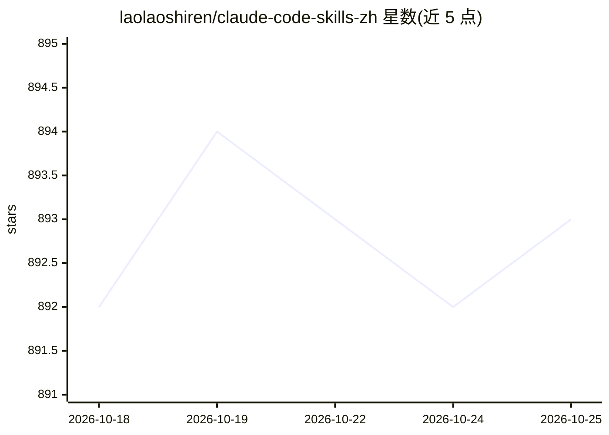

# laolaoshiren/claude-code-skills-zh

⭐ 894 · Python · MIT · 推送 2026-10-24 · [GitHub](https://github.com/laolaoshiren/claude-code-skills-zh) · [官网](https://claude-skills.bt199.com/) · 个人维护 · 中文 README

**中文开发者的 Claude Code Skills/Agents/Plugins 精选清单与原创技能库**

面向中文开发者的 Claude Code Skills 聚合仓库：按热门、开发效率、内容创作、学术科研、AI Agent、中文专属等场景分类收录 438+ 第三方技能项目，并提供可复制即装的原创技能包（zh-code-reviewer、zh-readme、api-tester、refactor-advisor、perf-profiler）。安装方式为 git clone 后复制 skills 目录到 ~/.claude/skills/。条目覆盖 Claude Code、Codex、Gemini CLI、Cursor 等多种 Agent 工具的兼容生态，并附官网与维护手册，声明持续更新。

## 筛选速览

| 维度 | 判定 | 备注 |
|---|---|---|
| AI 角色 | `ai-knowledge` | 知识聚合/清单类 |
| 许可风险 | `permissive` | MIT |
| 部署形态 | `library` | 以包/库形式分发 |
| 模型依赖 | — | README 未给出锁定关系 |
| 硬件要求 | — | 无带数字的原话,不猜 |
| 安装摩擦 | `high` | 编译与系统依赖俱全 |
| 成熟度 | — | 结构信号不足 |

## 能力要点

- 精选 438+ 第三方技能，按 8 个场景分类组织
- 5 个原创技能包（代码审查/中文 README/API 测试/重构/性能分析）
- git clone + cp 到 ~/.claude/skills/ 的复制即装流程
- 配套官网与分类筛选入口

## 适用场景

- 给 Claude Code 补齐代码审查、API 测试、性能分析等专业能力
- 按场景查找中文可读、复制即装的现成技能
- 了解 Claude Code / Codex / Cursor 等工具的技能生态

## 场景标签

`精选清单` `提示工程` · 领域:Agent 开发

## 证据(README 行号)

> L3: > 🚀 最实用的 Claude Code Skills / Agents / Plugins 合集 | 精选 438+ | 按场景分类 | 复制即装 | 持续更新
> L51: ## 📖 什么是 Claude Code Skills？
> L61: git clone https://github.com/laolaoshiren/claude-code-skills-zh.git

## 星数曲线

2026-10-18 892 → 2026-10-25 893（+1）

---
*卡片 v1 · prompt 1.4 · 生成 2026-10-21 · 置信度 mid · 依据 README sha `05ed9901caf1` · [字段定义](../../DATASET.md)*
