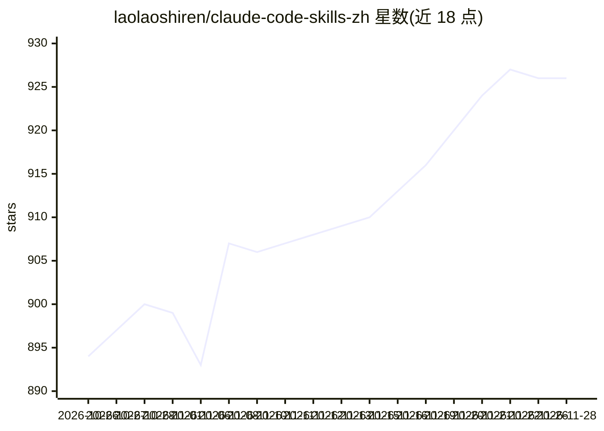

# laolaoshiren/claude-code-skills-zh

⭐ 926 · Python · MIT · 推送 2026-11-27 · [GitHub](https://github.com/laolaoshiren/claude-code-skills-zh) · [官网](https://claude-skills.bt199.com/) · 个人维护 · 中文 README

**中文开发者的 Claude Code Skills 精选与原创技能集**

面向中文开发者的 Claude Code Skills / Agents / Plugins 精选仓库：收录 453+ 经核验的第三方技能，按平台运营、开发效率、内容创作、学术科研、AI Agent、金融/商业、中文专属等场景分类，每条附中文说明与价值评述；另含 22 个自研原创中文技能（如 skill-translator、zh-code-reviewer），可通过 Claude Code 插件市场一条命令批量安装，或经 npx skills / git clone 按需单装，并给出 Codex、Cursor、Gemini CLI、OpenClaw 的技能目录路径对照表。MIT 许可，附官网检索。

## 筛选速览

| 维度 | 判定 | 备注 |
|---|---|---|
| AI 角色 | `ai-knowledge` | 知识聚合/清单类 |
| 许可风险 | `permissive` | MIT |
| 部署形态 | `library` | 以包/库形式分发 |
| 模型依赖 | — | README 未给出锁定关系 |
| 硬件要求 | — | 无带数字的原话,不猜 |
| 安装摩擦 | `high` | 编译与系统依赖俱全 |
| 成熟度 | — | 结构信号不足 |

## 能力要点

- 453+ 条核验精选条目按场景分类，含公众号/小红书/飞书/企微等国内平台技能独立分类
- 22 个原创中文技能，支持 /plugin marketplace 一条命令批量安装
- skill-translator 可将英文 SKILL.md 无损汉化并做安全与 Windows 兼容性预检
- 提供 Claude Code / Codex / Cursor / Gemini CLI / OpenClaw 五类客户端技能路径对照表

## 适用场景

- 为 Claude Code 快速补齐代码审查、README、API 测试等高频技能
- 查找公众号、小红书、飞书等国内平台运营相关技能
- 把高星英文技能汉化为中文触发版后使用
- 跨 Codex/Cursor/Gemini CLI 多工具复用同一套技能

## 场景标签

`精选清单` · 领域:学习与行业

## 证据(README 行号)

> L3: > 🚀 最实用的 Claude Code Skills / Agents / Plugins 合集 | 精选 453+ | 按场景分类 | 复制即装 | 持续更新
> L47: **claude-code-skills-zh（Claude Code Skills 中文精选集）** 是面向中文开发者的 Claude Code Skills / Agents / Plugins 精选仓库：**453+** 个
> L131: Claude Code Skills 是可复用的指令模块，让 Claude Code 拥有特定领域的专业能力。只需一个 `SKILL.md` 文件，就能让 Claude 变成代码审查专家、安全审计师、文档写手…

## 星数曲线

2026-10-26 894 → 2026-11-28 926（+32）

---
*卡片 v1 · prompt 1.4 · 生成 2026-11-28 · 置信度 mid · 依据 README sha `3d59ae0523ae` · [字段定义](../../DATASET.md)*
