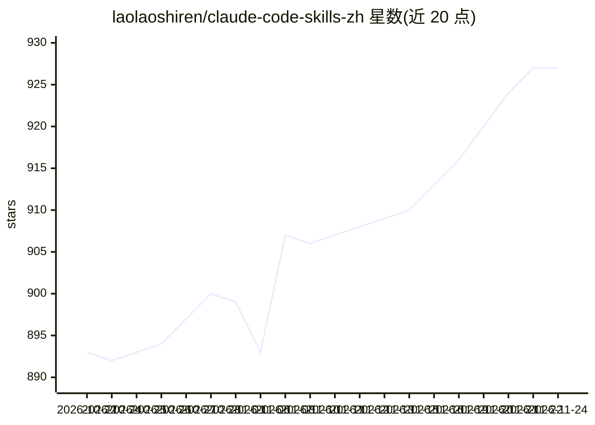

# laolaoshiren/claude-code-skills-zh

⭐ 927 · Python · MIT · 推送 2026-11-16 · [GitHub](https://github.com/laolaoshiren/claude-code-skills-zh) · [官网](https://claude-skills.bt199.com/) · 个人维护 · 中文 README

**中文开发者的 Claude Code Skills 精选与原创技能库**

面向中文开发者的 Claude Code Skills / Agents / Plugins 精选仓库，收录 445+ 第三方技能并按平台运营、开发效率、内容创作、学术科研、AI Agent、金融/商业、中文专属等场景分类；另含 21 个自研原创中文技能（如 zh-code-reviewer、api-tester）。每条描述以中文说明适用场景与安装方式，并通过 Claude Code 插件市场命令或 git clone 复制到 ~/.claude/skills 安装。MIT 许可，持续更新。

## 筛选速览

| 维度 | 判定 | 备注 |
|---|---|---|
| AI 角色 | `ai-knowledge` | 知识聚合/清单类 |
| 许可风险 | `permissive` | MIT |
| 部署形态 | `library` | 以包/库形式分发 |
| 模型依赖 | — | README 未给出锁定关系 |
| 硬件要求 | — | 无带数字的原话,不猜 |
| 安装摩擦 | `high` | 编译与系统依赖俱全 |
| 成熟度 | — | 结构信号不足 |

## 能力要点

- 445+ 第三方技能按场景分类，附中文说明
- 21 个自研原创中文技能，插件市场一条命令安装
- 国内平台（公众号/小红书/飞书/企业微信/B站/抖音）技能独立分类
- 兼容 Claude Code 之外还标注 Cursor / Codex / Gemini CLI 等工具适配

## 适用场景

- 为 Claude Code 快速补齐代码审查、README、API 测试等能力
- 找中文可读、复制即装的 Agent 技能
- 查找公众号、小红书、飞书等国内平台运营技能

## 场景标签

`精选清单` · 领域:学习与行业

## 证据(README 行号)

> L35: **claude-code-skills-zh（Claude Code Skills 中文精选集）** 是面向中文开发者的 Claude Code Skills / Agents / Plugins 精选仓库：**445+** 个
> L61: |分类|一句话说明|常见场景|
> L98: ## 📖 什么是 Claude Code Skills？

## 星数曲线

2026-10-22 893 → 2026-11-24 927（+34）

---
*卡片 v1 · prompt 1.4 · 生成 2026-11-24 · 置信度 mid · 依据 README sha `1302a9890f0a` · [字段定义](../../DATASET.md)*
