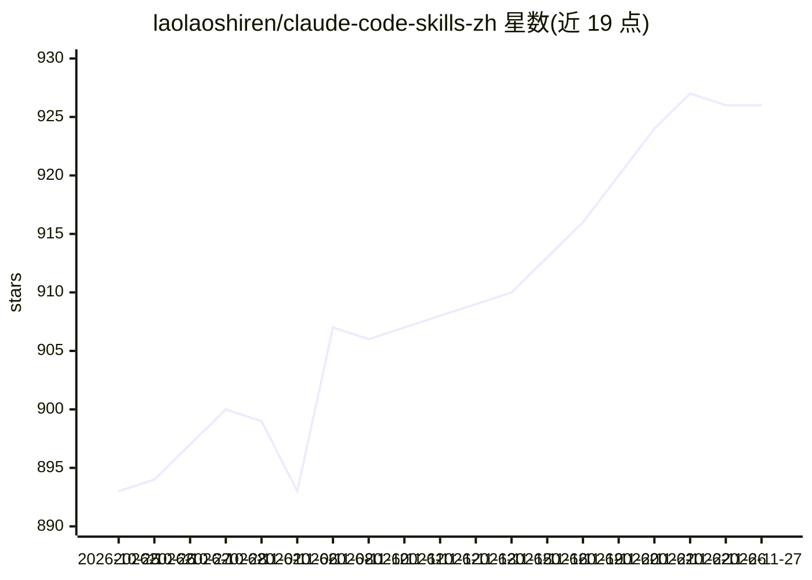

# laolaoshiren/claude-code-skills-zh

⭐ 926 · Python · MIT · 推送 2026-11-26 · [GitHub](https://github.com/laolaoshiren/claude-code-skills-zh) · [官网](https://claude-skills.bt199.com/) · 个人维护 · 中文 README

**面向中文开发者的 Claude Code 技能精选集与原创技能包**

面向中文开发者的 Claude Code Skills / Agents / Plugins 精选仓库：收录 452+ 条经核验的第三方技能，按平台运营、开发效率、内容创作、学术科研、AI Agent、中文专属等场景分类，每条附中文说明与安装方式；另含 22 个可直接安装的原创中文技能（skill-translator、zh-code-reviewer、api-tester 等）。支持通过 Claude Code 插件市场一条命令安装全部原创技能，也可克隆仓库按需单装，提供 Codex / Cursor / Gemini CLI / OpenClaw 的技能目录路径对照。MIT 许可。

## 筛选速览

| 维度 | 判定 | 备注 |
|---|---|---|
| AI 角色 | `ai-knowledge` | 知识聚合/清单类 |
| 许可风险 | `permissive` | MIT |
| 部署形态 | `library` | 以包/库形式分发 |
| 模型依赖 | — | README 未给出锁定关系 |
| 硬件要求 | — | 无带数字的原话,不猜 |
| 安装摩擦 | `high` | 编译与系统依赖俱全 |
| 成熟度 | — | 结构信号不足 |

## 能力要点

- 452+ 条核验精选条目按场景分类，附中文说明
- 22 个原创中文技能，插件市场一条命令安装
- 提供 Claude Code / Codex / Cursor / Gemini CLI / OpenClaw 技能路径对照表
- skill-translator 可将英文 SKILL.md 无损转为中文触发版

## 适用场景

- 为 Claude Code 快速补充代码审查、测试、重构等技能
- 查找公众号、小红书、飞书等国内平台运营技能
- 将英文高星技能汉化为中文触发版本
- 跨多个 AI 编码工具复用同一套技能文件

## 场景标签

`精选清单` `提示工程` · 领域:Agent 开发

## 证据(README 行号)

> L47: **claude-code-skills-zh（Claude Code Skills 中文精选集）** 是面向中文开发者的 Claude Code Skills / Agents / Plugins 精选仓库：**452+** 个
> L3: > 🚀 最实用的 Claude Code Skills / Agents / Plugins 合集 | 精选 452+ | 按场景分类 | 复制即装 | 持续更新
> L92: |分类|一句话说明|常见场景|

## 星数曲线

2026-10-25 893 → 2026-11-27 926（+33）

---
*卡片 v1 · prompt 1.4 · 生成 2026-11-27 · 置信度 mid · 依据 README sha `1c2c5396be3c` · [字段定义](../../DATASET.md)*
