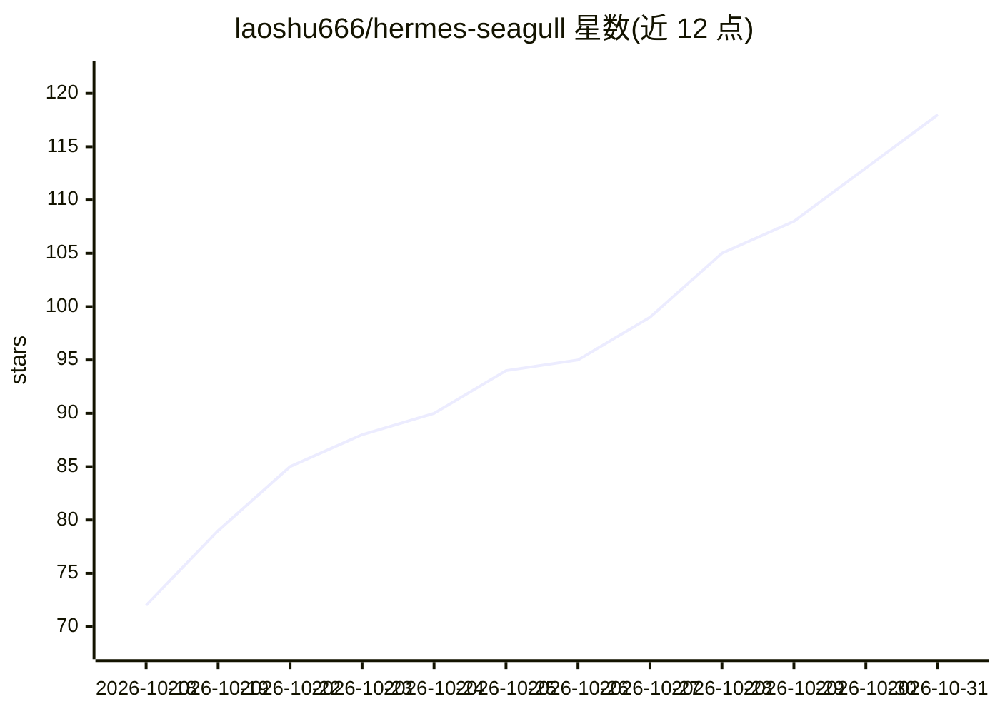

# laoshu666/hermes-seagull

⭐ 118 · PowerShell · MIT · 推送 2026-09-12 · [GitHub](https://github.com/laoshu666/hermes-seagull) · [官网](https://hermes-agent.nousresearch.com) · 个人维护 · 中文 README

**面向 Hermes Agent 的 CTF/红队 AI 人格插件**

作为 Hermes Agent 的 profile 插件部署的增强型人格配置：通过 hermes profile install 命令行安装，叠加不覆盖原有设置。激活后提供 CTF、逆向工程、渗透测试、游戏安全、免杀、漏洞利用等安全研究方向的对话模式与技能路由，包含

## 筛选速览

| 维度 | 判定 | 备注 |
|---|---|---|
| AI 角色 | `ai-ecosystem` | LLM/agent 周边工具 |
| 许可风险 | `permissive` | MIT |
| 部署形态 | `None` |  |
| 模型依赖 | — | README 未给出锁定关系 |
| 硬件要求 | — | 无带数字的原话,不猜 |
| 安装摩擦 | `low` | 无编译、无系统依赖或容器化 |
| 成熟度 | — | 结构信号不足 |

## 能力要点

- 插件式部署，一条命令安装，不覆盖原有 Hermes 设置
- 提供 CTF/逆向/渗透/游戏安全/免杀等多领域模式切换命令
- 支持通过 --force 参数强制重新部署同步更新

## 适用场景

- 给 Hermes Agent 叠加安全研究方向的专属人格与技能
- CTF 竞赛与红队场景下按需切换逆向/渗透/免杀等模式
- 已有 Hermes 使用习惯的用户增量部署安全能力配置

## 场景标签

`网络安全` · 领域:学习与行业

## 证据(README 行号)

> L3: **基于 Hermes Plugin 的 CTF/Red-team/Reverse/Pentest 全域插件**
> L9: 海鸥是增强型插件，通过 Hermes 的 profile 系统以插件方式部署：

## 星数曲线

2026-10-18 72 → 2026-10-31 118（+46）

---
*卡片 v1 · prompt 1.4 · 生成 2026-10-23 · 置信度 mid · 依据 README sha `6a8f982fe8de` · [字段定义](../../DATASET.md)*
