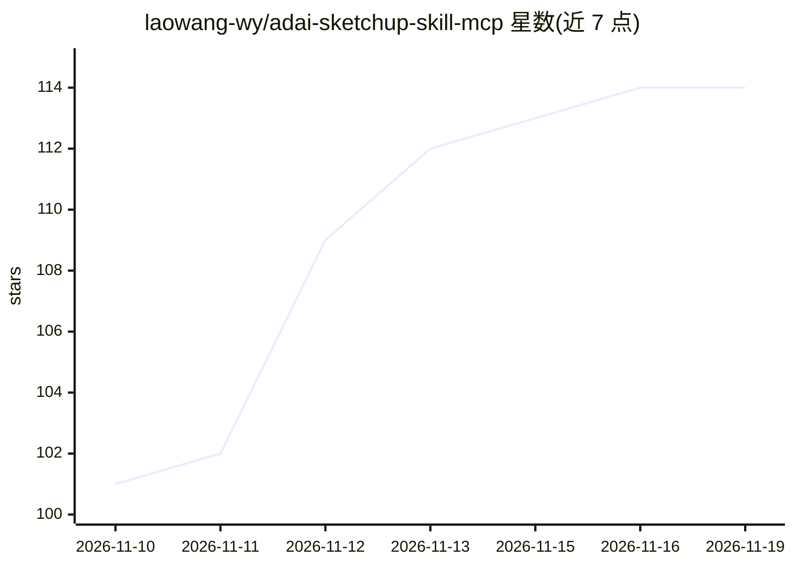

# laowang-wy/adai-sketchup-skill-mcp

⭐ 114 · JavaScript · NOASSERTION · 推送 2026-11-09 · [GitHub](https://github.com/laowang-wy/adai-sketchup-skill-mcp) · 个人维护 · 中文 README

**让 AI Agent 在 SketchUp 中做可编辑建筑建模的 MCP 服务器与 Skill**

由 ADAI 开发的 SketchUp MCP 服务器与配套建模 Skill：AI Agent 依据图片、CAD、文字或已有模型构造可编辑 SKP 文件。机制上通过本地 Ruby 桥接插件执行受管写入，提供事务、操作回执、未知写入恢复、真实几何回读与封存视图取证；guided 模式按六阶段逐个执行并看图纠错，expert 模式用触发词选择连续工作单元。面向 Codex / PipClaw 于 Windows，当前适配 SketchUp 2018/2019（原生验证聚焦 2019）；不承诺自动 CAD 识图、工程量统计或结构规范审查，2021+ 未验证。

## 筛选速览

| 维度 | 判定 | 备注 |
|---|---|---|
| AI 角色 | `ai-ecosystem` | LLM/agent 周边工具 |
| 许可风险 | `none` | NOASSERTION |
| 部署形态 | `desktop` | 安装包/桌面程序 |
| 模型依赖 | — | README 未给出锁定关系 |
| 硬件要求 | — | 无带数字的原话,不猜 |
| 安装摩擦 | `low` | 无编译、无系统依赖或容器化 |
| 成熟度 | — | 结构信号不足 |

## 能力要点

- MCP 执行受管 Ruby 写入、真实几何回读与未知写入恢复
- guided 六阶段逐个执行并看图纠错，expert 触发词选择连续工作单元
- 尺寸目标与 SU 实测读回比较、封存视图与原图对照取证
- 内置古建经验包 adai-ancient-architecture，其他 REF 包单独加载

## 适用场景

- 让 Codex/PipClaw 根据图片或 CAD 生成可编辑的 SketchUp 建筑模型
- 对已有 SKP 模型做定向局部修改并保留其他成果
- 古建建模与立面构件构造

## 场景标签

`GUI 自动化` · 领域:效率与自动化

## 证据(README 行号)

> L3: **SketchUp MCP + Skill for AI modeling agents.** Prompt-driven, editable 3D modeling with managed Ruby transactions,
> L19: MCP 对客户端使用 **stdio**；SketchUp 端通过本地 Ruby 桥接插件执行，默认桥接通道为文件。当前适配 Codex / PipClaw；其他 MCP 客户端需另行验证，不能据此宣称 Claude 已完成适配。

## 星数曲线

2026-11-10 101 → 2026-11-19 114（+13）

---
*卡片 v1 · prompt 1.4 · 生成 2026-11-17 · 置信度 high · 依据 README sha `03113cd48fc1` · [字段定义](../../DATASET.md)*
