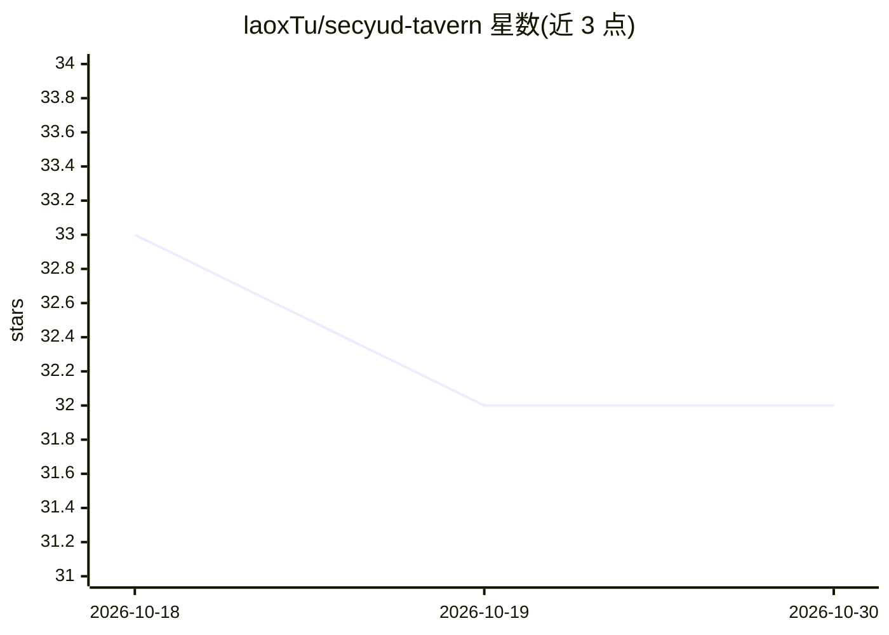

# laoxTu/secyud-tavern

⭐ 32 · TypeScript · AGPL-3.0 · 推送 2026-10-27 · [GitHub](https://github.com/laoxTu/secyud-tavern) · [官网](https://github.com/laoxTu/secyud-tavern-docs) · 个人维护 · 中文 README

**面向用户的 AI 角色扮演与互动叙事平台**

基于 TypeScript 的 Web 平台，提供 AI 角色扮演与互动叙事功能，自称高度可定制。通过 pnpm 安装依赖、执行前置脚本后构建并以 pnpm start 启动本地服务（默认端口 12804）。支持编译期插件机制，可在 manifest.json 中禁用插件并重启生效；提供导入插件，可导入 SillyTavern 格式的角色卡与预设，但仅限文字描述类内容，不支持复刻脚本。采用 AGPL v3.0 协议开源。

## 筛选速览

| 维度 | 判定 | 备注 |
|---|---|---|
| AI 角色 | `ai-native` | 本体是模型或模型工具 |
| 许可风险 | `viral` | AGPL-3.0 |
| 部署形态 | `library` | 以包/库形式分发 |
| 模型依赖 | — | README 未给出锁定关系 |
| 硬件要求 | — | 无带数字的原话,不猜 |
| 安装摩擦 | `low` | 无编译、无系统依赖或容器化 |
| 成熟度 | — | 结构信号不足 |

## 能力要点

- AI 角色扮演与互动叙事平台，支持本地部署运行
- 编译期插件机制，可通过 manifest.json 禁用后重启生效
- 提供 SillyTavern 格式角色卡与预设的导入插件

## 适用场景

- 本地运行一个 AI 角色扮演聊天平台
- 导入已有的 SillyTavern 角色卡与预设继续使用
- 通过插件机制扩展平台功能

## 场景标签

`聊天机器人` · 领域:对话与助手

## 证据(README 行号)

> L3: 一个高度可定制化的 AI 角色扮演与互动叙事平台。
> L5: A highly customizable AI role-playing and interactive storytelling platform.

## 星数曲线

2026-10-18 33 → 2026-10-30 32（-1）

---
*卡片 v1 · prompt 1.4 · 生成 2026-10-26 · 置信度 mid · 依据 README sha `24b442b20675` · [字段定义](../../DATASET.md)*
