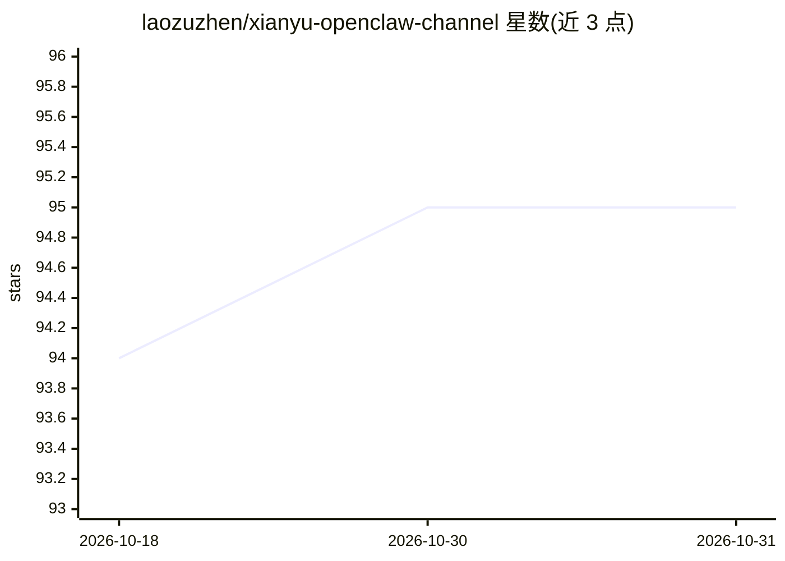

# laozuzhen/xianyu-openclaw-channel

⭐ 95 · Python · 推送 2026-03-08 · [GitHub](https://github.com/laozuzhen/xianyu-openclaw-channel) · 个人维护 · 中文 README

**将闲鱼消息接入 OpenClaw AI Agent 的频道插件**

闲鱼（Goofish）交易平台与 OpenClaw AI Agent 之间的频道插件：TypeScript 频道适配器经 HTTP/SSE 桥接 Python 后端，后端通过 WebSocket 连接闲鱼，实现消息接入、上下文对话、自动回复、付款后自动发货、商品批量发布与商品搜索爬取。向 Agent 注册 8 个可调用工具（发布商品、订单、发货、搜索等），支持多账号管理。也提供仅 Python 的独立自动回复模式。限制：商品发布的滑块验证为双物体拼接类型，可能需人工辅助或第三方打码；仅供学习研究，禁止商业用途。

## 筛选速览

| 维度 | 判定 | 备注 |
|---|---|---|
| AI 角色 | `ai-ecosystem` | LLM/agent 周边工具 |
| 许可风险 | `none` | — |
| 部署形态 | `None` |  |
| 模型依赖 | — | README 未给出锁定关系 |
| 硬件要求 | — | 无带数字的原话,不猜 |
| 安装摩擦 | `low` | 无编译、无系统依赖或容器化 |
| 成熟度 | — | 结构信号不足 |

## 能力要点

- TypeScript 插件经 HTTP/SSE Bridge 模式桥接 Python 后端，安全隔离
- 注册 8 个供 Agent 调用的闲鱼工具（发布/订单/发货/搜索等）
- 检测付款消息自动确认发货，支持多账号
- Playwright 自动化商品发布（单个/批量）

## 适用场景

- 闲鱼卖家让 AI Agent 自动回复买家消息
- 虚拟商品付款后自动确认发货
- 通过对话批量发布或搜索闲鱼商品

## 场景标签

`聊天机器人` · 领域:对话与助手

## 证据(README 行号)

> L8: > 将闲鱼二手交易平台的消息接入 OpenClaw AI Agent，实现智能客服、自动回复、自动发货、商品发布等功能。
> L24: OpenClaw Agent ←→ Channel Plugin (TS) ←HTTP/SSE→ Bridge API (Python) ←WebSocket→ 闲鱼
> L120: 闲鱼插件注册了以下工具供 AI Agent 调用：

## 星数曲线

2026-10-18 94 → 2026-10-31 95（+1）

---
*卡片 v1 · prompt 1.4 · 生成 2026-10-23 · 置信度 high · 依据 README sha `e41de75ab320` · [字段定义](../../DATASET.md)*
