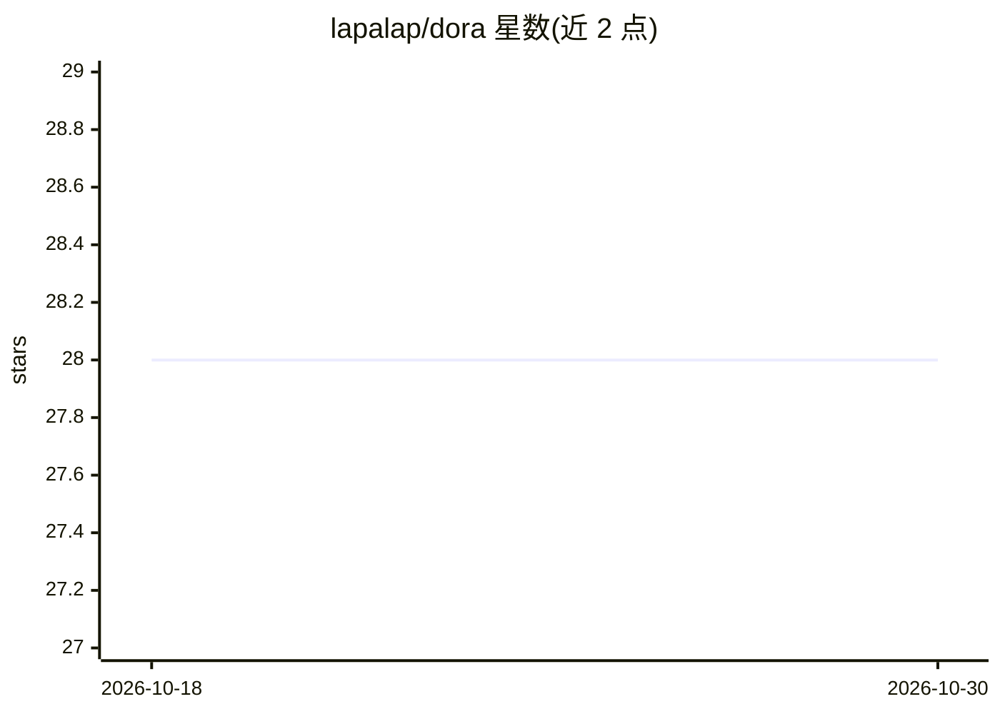

# lapalap/dora

⭐ 28 · Python · MIT · 推送 2026-04-23 · [GitHub](https://github.com/lapalap/dora) · 个人维护

**检测深度神经网络中虚假概念表示的 PyTorch 分析工具**

论文配套工具包（arXiv:2206.04530）：对任意给定的 PyTorch 深度学习模型，无需依赖数据，自动检测表示空间中学习到虚假或伪影概念的异常神经元（infected neurons）；检测到的异常表示可用作伪影检测器，对给定数据集进行感染数据点的自动检测与清洗。使用激活最大化生成合成信号并采集层编码，提供 Colab notebook 与 pip 源码安装，许可证为 GNU GPL v3.0。

## 筛选速览

| 维度 | 判定 | 备注 |
|---|---|---|
| AI 角色 | `ai-native` | 本体是模型或模型工具 |
| 许可风险 | `permissive` | MIT |
| 部署形态 | `library` | 以包/库形式分发 |
| 模型依赖 | — | README 未给出锁定关系 |
| 硬件要求 | — | 无带数字的原话,不猜 |
| 安装摩擦 | `low` | 无编译、无系统依赖或容器化 |
| 成熟度 | — | 结构信号不足 |

## 能力要点

- Data-agnostic：不依赖数据即可检测异常表示
- 适用于任意给定 DL 模型的神经元级表示分析
- 检测到的感染表示可复用为数据集伪影检测器并清洗数据点
- 基于激活最大化生成合成信号并采集编码

## 适用场景

- 检查训练好的网络中是否学到伪影或虚假概念的神经元
- 利用感染表示自动检测并清洗数据集中的感染样本
- 在 Colab 中分析预训练 resnet18 的表示空间

## 场景标签

 · 领域:机器学习/可解释性

## 证据(README 行号)

> L15: Data-agnOstic Representation analysis – *DORA* – is the automatic framework for inspecting the representation space
> L16: Independent of data, for any given DL model DORA, allows to automatically detect anomalous representations, that be
> L56:   journal={arXiv preprint arXiv:2206.04530},

## 星数曲线

2026-10-18 28 → 2026-10-30 28（+0）

---
*卡片 v1 · prompt 1.4 · 生成 2026-10-26 · 置信度 high · 依据 README sha `0e3e34fb04fa` · [字段定义](../../DATASET.md)*
