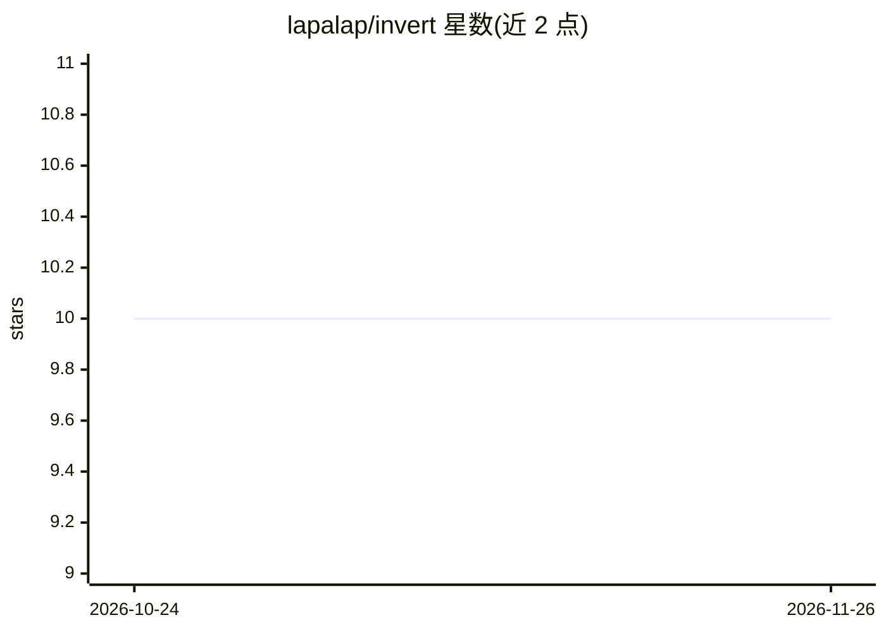

# lapalap/invert

⭐ 10 · Jupyter Notebook · 推送 2025-12-03 · [GitHub](https://github.com/lapalap/invert) · 组织维护

**面向研究者的 DNN 表征可解释标注方法库（NeurIPS 2023）**

NeurIPS 2023 论文 INVERT 的官方代码库，提供 pip 安装的 Python 库。方法对深度神经网络的层级表征做概念标注：将激活向量与人类可理解概念对齐，输出 AUROC 等可解释指标。1.2 版引入基于 HDF5 的批量解释路径，支持流式写入激活数据与全向量化解释搜索，减少重复逐神经元遍历与显存占用；旧版 explain_representation API 保持向后兼容。附 Colab 示例笔记本，面向做可解释性研究的用户。

## 筛选速览

| 维度 | 判定 | 备注 |
|---|---|---|
| AI 角色 | `ai-native` | 本体是模型或模型工具 |
| 许可风险 | `none` | — |
| 部署形态 | `library` | 以包/库形式分发 |
| 模型依赖 | — | README 未给出锁定关系 |
| 硬件要求 | — | 无带数字的原话,不猜 |
| 安装摩擦 | `medium` | 含编译或系统依赖之一 |
| 成熟度 | — | 结构信号不足 |

## 能力要点

- 通过逆向识别为 DNN 表征生成概念标签并给出 AUROC 指标
- HDF5 流式写入 + 全向量化批量解释搜索（v1.2）
- explain_representation 经典 API 向后兼容
- 提供 Colab 笔记本快速上手

## 适用场景

- 解释深度网络各层激活与人类概念的对应关系
- 对大规模层与数据集做批量表征标注
- 复现论文实验或在其基础上扩展可解释性方法

## 场景标签

`科研工具` · 领域:学习与行业

## 证据(README 行号)

> L2:  Accepted at 37th Conference on Neural Information Processing Systems (NeurIPS 2023)
> L9: Inverse Recognition (INVERT) is a method designed to enhance our understanding of the representations learned by Dee
> L21: This release brings a major speed-up path for INVERT via **HDF5-based, batched explanations**—ideal for large layer

## 星数曲线

2026-10-24 10 → 2026-11-26 10（+0）

---
*卡片 v1 · prompt 1.4 · 生成 2026-11-19 · 置信度 high · 依据 README sha `4e4c410d0d43` · [字段定义](../../DATASET.md)*
