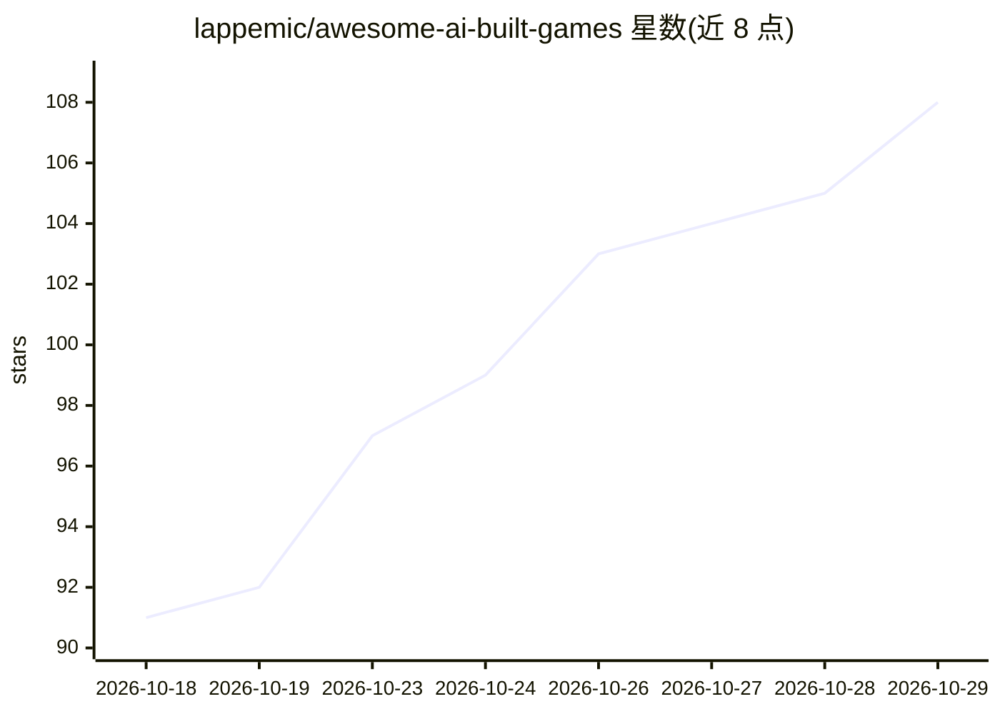

# lappemic/awesome-ai-built-games

⭐ 108 · CC0-1.0 · 推送 2026-10-27 · [GitHub](https://github.com/lappemic/awesome-ai-built-games) · 个人维护

**AI 编程代理制作的可玩游戏策展清单**

一个 awesome 风格的游戏清单：收录由 Claude Code、Cursor、Codex、GPT、Gemini、Grok、Lovable 等 AI 编程代理编写代码并可直接游玩的游戏，多数为浏览器游戏。条目按动作射击、竞速、冒险开放世界、模拟策略、解谜、街机等类型分组，每条说明玩法，作者披露时同时标注所用 AI 工具与引擎（Three.js、Phaser、Godot 等）。收录 Vibe Jam、AI Browser Game Jam 等活动的获奖作品，支持无 PR 的提交通道。

## 筛选速览

| 维度 | 判定 | 备注 |
|---|---|---|
| AI 角色 | `ai-knowledge` | 知识聚合/清单类 |
| 许可风险 | `viral` | CC0-1.0 |
| 部署形态 | `desktop` | 安装包/桌面程序 |
| 模型依赖 | — | README 未给出锁定关系 |
| 硬件要求 | — | 无带数字的原话,不猜 |
| 安装摩擦 | `low` | 无编译、无系统依赖或容器化 |
| 成熟度 | — | 结构信号不足 |

## 能力要点

- 按 6 个游戏类型分组收录可玩的 AI 生成游戏
- 条目标注所用 AI 编程代理与游戏引擎
- 收录 Vibe Jam / AI Browser Game Jam 获奖作品
- 支持免 PR 提交收录自己用 AI 做的游戏

## 适用场景

- 寻找可直接游玩的 AI 编程代理制作的浏览器游戏
- 了解各 AI 编程工具在游戏开发中的实际产出
- 提交展示自己 vibe-code 出的游戏作品

## 场景标签

`精选清单` · 领域:学习与行业

## 证据(README 行号)

> L5: A curated list of the best vibe-coded games: playable games built with AI coding agents like Claude Code, Cursor, Co
> L13: Hand-picked AI games, grouped by genre. Each entry says what you do in the game. Where the creator shares it, the e

## 星数曲线

2026-10-18 91 → 2026-10-29 108（+17）

---
*卡片 v1 · prompt 1.4 · 生成 2026-10-23 · 置信度 high · 依据 README sha `537d953df774` · [字段定义](../../DATASET.md)*
