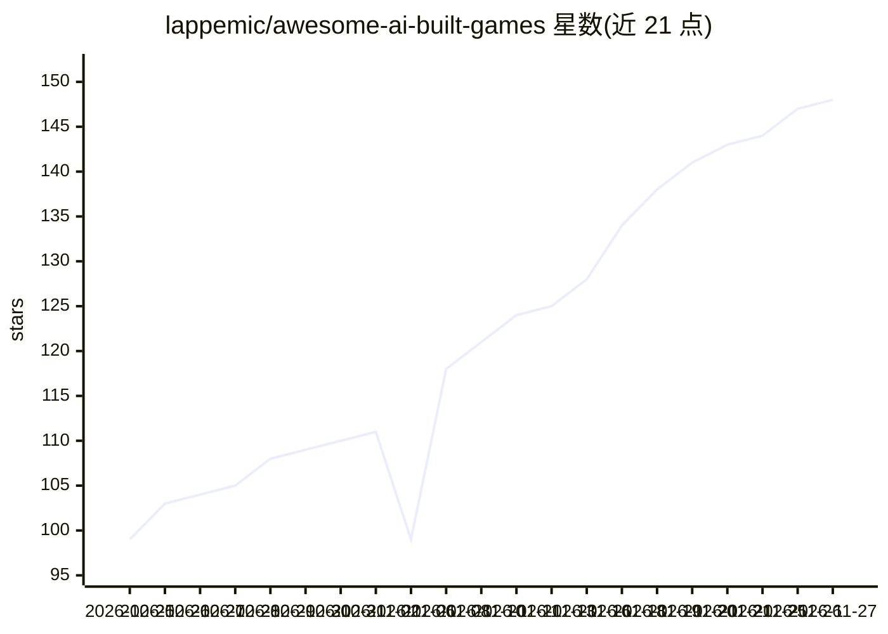

# lappemic/awesome-ai-built-games

⭐ 148 · CC0-1.0 · 推送 2026-11-25 · [GitHub](https://github.com/lappemic/awesome-ai-built-games) · 个人维护

**AI 编程代理开发的可玩游戏策展清单**

按体裁（动作射击、竞速、开放世界、模拟策略等）收录由 AI 编码代理编写大部分代码的可玩游戏条目，每条说明玩法、所用 AI 工具与游戏引擎（Three.js/Phaser/Godot 等），多数可直接在浏览器游玩。收录标准为 AI 编写各游戏的大部分代码且当前可玩，读者可通过表单提交新游戏，无需 pull request。

## 筛选速览

| 维度 | 判定 | 备注 |
|---|---|---|
| AI 角色 | `ai-knowledge` | 知识聚合/清单类 |
| 许可风险 | `viral` | CC0-1.0 |
| 部署形态 | `desktop` | 安装包/桌面程序 |
| 模型依赖 | — | README 未给出锁定关系 |
| 硬件要求 | — | 无带数字的原话,不猜 |
| 安装摩擦 | `low` | 无编译、无系统依赖或容器化 |
| 成熟度 | — | 结构信号不足 |

## 能力要点

- 按游戏体裁分组的策展清单，逐条标注 AI 工具与引擎
- 收录标准明确：AI 编写大部分代码且当前可玩，多数浏览器可直接游玩
- 支持无需 pull request 的表单提交收录
- 标注 Vibe Jam / AI Browser Game Jam 等活动获奖信息

## 适用场景

- 查找可直接在浏览器试玩的 AI 生成游戏
- 了解 Claude Code、Cursor 等工具做游戏开发的实际产出
- 为自己用 AI 开发的游戏寻找收录渠道

## 场景标签

`编码 Agent` `精选清单` · 领域:编码与开发

## 证据(README 行号)

> L5: A curated list of the best vibe-coded games: playable games built with AI coding agents like Claude Code, Cursor, Co
> L13: Hand-picked AI games, grouped by genre. Each entry says what you do in the game. Where the creator shares it, the e

## 星数曲线

2026-10-25 99 → 2026-11-27 148（+49）

---
*卡片 v1 · prompt 1.4 · 生成 2026-11-27 · 置信度 mid · 依据 README sha `9484d68f0134` · [字段定义](../../DATASET.md)*
