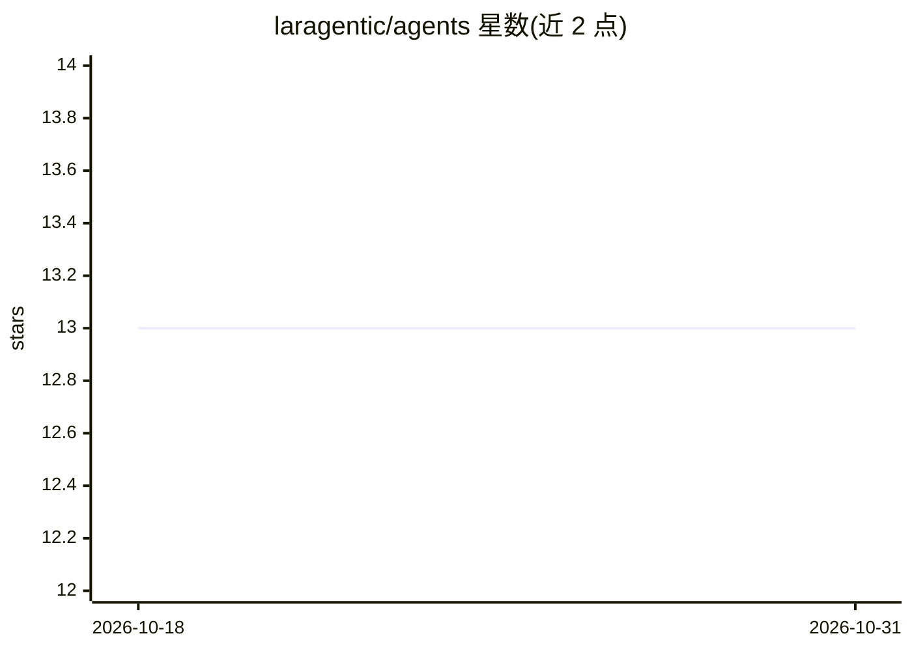

# laragentic/agents

⭐ 13 · PHP · 推送 2026-03-18 · [GitHub](https://github.com/laragentic/agents) · 组织维护

**为 Laravel AI SDK 扩展自主 agent 循环的 PHP 包**

基于 Composer 的 Laravel 包（laragentic/agents），在 Laravel AI SDK 之上为 agent 类添加 ReAct、Plan-Execute、Chain-of-Thought 三种循环 trait，使 agent 能自主推理、调用工具、观察结果并迭代至产出答案。另提供技能自动发现加载、全阶段生命周期回调（可配合 SSE 流式输出到前端）、迭代/步数上限与自适应重规划等配置。要求 PHP 8.2+、Laravel 12.x 与 Laravel AI SDK，加一个 trait 即可用，无需额外配置。

## 筛选速览

| 维度 | 判定 | 备注 |
|---|---|---|
| AI 角色 | `ai-ecosystem` | LLM/agent 周边工具 |
| 许可风险 | `none` | — |
| 部署形态 | `library` | 以包/库形式分发 |
| 模型依赖 | — | README 未给出锁定关系 |
| 硬件要求 | — | 无带数字的原话,不猜 |
| 安装摩擦 | `low` | 无编译、无系统依赖或容器化 |
| 成熟度 | — | 结构信号不足 |

## 能力要点

- 三种循环：ReAct、Plan-Execute、Chain-of-Thought
- Agent 技能系统的动态加载与自动发现
- 全阶段生命周期回调，支持 eventStream 流式推送
- 可配置最大迭代/步数与自适应重规划

## 适用场景

- 在 Laravel 应用中构建可自主调用工具的对话 agent
- 多步骤任务的规划-执行-重规划流程
- 数学/逻辑类问题的迭代自反思推理

## 场景标签

`Agent 框架` · 领域:Agent 开发

## 证据(README 行号)

> L5: Laragentic extends the Laravel AI SDK with agentic loops — letting your agents autonomously reason, call tools, and 
> L40: The Laravel AI SDK gives you agents, tools, streaming, and conversations. But when you call `prompt()`, the agent r

## 星数曲线

2026-10-18 13 → 2026-10-31 13（+0）

---
*卡片 v1 · prompt 1.4 · 生成 2026-10-31 · 置信度 mid · 依据 README sha `9b57e4316b53` · [字段定义](../../DATASET.md)*
