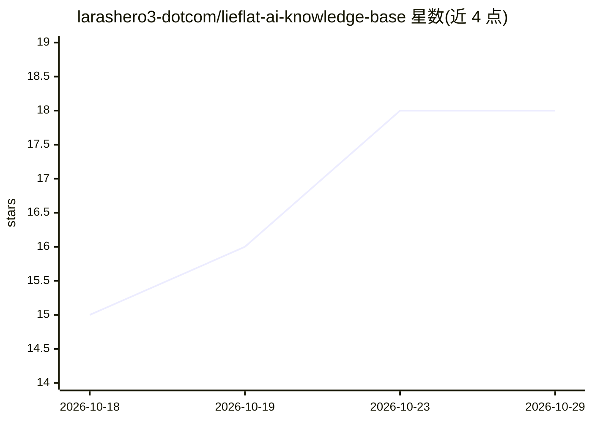

# larashero3-dotcom/lieflat-ai-knowledge-base

⭐ 18 · 推送 2026-08-17 · [GitHub](https://github.com/larashero3-dotcom/lieflat-ai-knowledge-base) · [官网](https://moxt.ai/w/jjkaatvr/b9ccdab1-8b96-4c6c-a6f2-d71005e7c9a7) · 个人维护 · 中文 README

**追踪 GitHub 热点与 AI 动态的免费知识库（已 100+ 篇播报）**

由个人博主「躺在废墟里」维护、托管在 Moxt 平台上的免费公开知识库：每周更新 4 次 GitHub 热点项目播报（已累计 100+ 篇），覆盖 AI Agent、开发工具、效率工具、模型应用方向，另发布 GitHub Trending 周报，介绍项目亮点与使用场景。配套飞书社群（限企业内部成员）与小红书、抖音、B站等社交渠道。内容免费公开但禁止未经授权的二次商业使用。

## 筛选速览

| 维度 | 判定 | 备注 |
|---|---|---|
| AI 角色 | `ai-knowledge` | 知识聚合/清单类 |
| 许可风险 | `none` | — |
| 部署形态 | `None` |  |
| 模型依赖 | — | README 未给出锁定关系 |
| 硬件要求 | — | 无带数字的原话,不猜 |
| 安装摩擦 | `low` | 无编译、无系统依赖或容器化 |
| 成熟度 | — | 结构信号不足 |

## 能力要点

- 每周 4 次更新 GitHub 热点项目播报，累计 100+ 篇
- GitHub Trending 周报汇总一周值得关注项目
- 托管于 Moxt 平台，在线免费阅读

## 适用场景

- 我想快速了解本周 GitHub 上值得关注的 AI 与开源项目
- 追踪开源社区新工具、新框架与新趋势
- 通过社群交流 AI 工具的使用方法

## 场景标签

`精选清单` · 领域:学习与行业

## 证据(README 行号)

> L3: 一个免费公开、持续更新的 AI 知识库。这里长期追踪 GitHub 热点项目与 AI 行业动态，帮你从快速变化的信息里，找到真正值得关注和使用的工具。
> L5: > **每周更新 4 次，GitHub 热点项目播报已累计 100+ 篇。**

## 星数曲线

2026-10-18 15 → 2026-10-29 18（+3）

---
*卡片 v1 · prompt 1.4 · 生成 2026-10-29 · 置信度 high · 依据 README sha `dcc906b270f3` · [字段定义](../../DATASET.md)*
