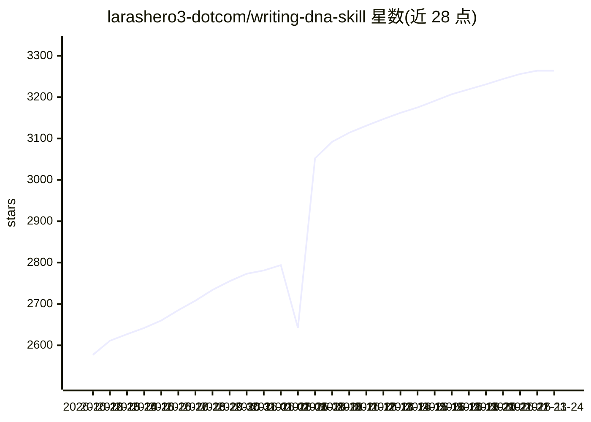

# larashero3-dotcom/writing-dna-skill

⭐ 3,278 · NOASSERTION · 推送 2026-11-11 · [GitHub](https://github.com/larashero3-dotcom/writing-dna-skill) · [官网](https://lieflat.work/skills/writing-dna/) · 个人维护

**给内容创作者：蒸馏复刻任意作者写作风格的 agent skill**

一个供 agent 加载的 skill，将一批完整文章（建议至少 20 篇）按六个层次蒸馏成可复用的风格规则：表层语言、文章结构、选题逻辑、素材策略、认知框架与视觉风格，分别输出语言DNA.md、文章结构模板.md 等产物，并整合为 Writing-DNA.md。写作前要求 agent 重读全部蒸馏产物并校准 5 篇最近原文。附带的 lieflat-less-ai-tone 规则用于清理 AI 痕迹。当前版本采用 PolyForm 非商业许可，商业使用需另行授权。

## 筛选速览

| 维度 | 判定 | 备注 |
|---|---|---|
| AI 角色 | `ai-native` | 本体是模型或模型工具 |
| 许可风险 | `none` | NOASSERTION |
| 部署形态 | `None` |  |
| 模型依赖 | — | README 未给出锁定关系 |
| 硬件要求 | — | 无带数字的原话,不猜 |
| 安装摩擦 | `low` | 无编译、无系统依赖或容器化 |
| 成熟度 | — | 结构信号不足 |

## 能力要点

- 六层蒸馏流程：语言/结构/选题/素材/认知框架/视觉风格，输出分层的规则文档
- 中英文产物分离：对话语言与产物语言可分别指定
- 写作前硬性读取步骤：全部蒸馏产物加 5 篇体裁最近的原文校准
- 附带 lieflat-less-ai-tone 白名单式去 AI 味改写规则

## 适用场景

- 沉淀自己过去文章的写作风格资产
- 分析某账号/作者的稳定风格供 agent 复刻
- 对比多个作者在同一议题上的表达差异

## 场景标签

`AI 写作` · 领域:内容生成

## 证据(README 行号)

> L11: 所以做了这个可以蒸馏任意账号/作者写作风格的 agent skill，让写作不再痛苦，不再从 0 开始难产。
> L13: 它并不是简单的“模仿某某风格”提示词，整个 skill 包含了一套完整的蒸馏流程，让 agent 把一批完整文章拆解成可复用的 Writing DNA，包括语言、结构、选题、素材、认知框架与视觉风格。蒸馏完成后，agent 可以在

## 星数曲线

2026-10-22 2,577 → 2026-11-24 3,264（+687）

---
*卡片 v1 · prompt 1.4 · 生成 2026-11-23 · 置信度 high · 依据 README sha `179e8931e539` · [字段定义](../../DATASET.md)*
