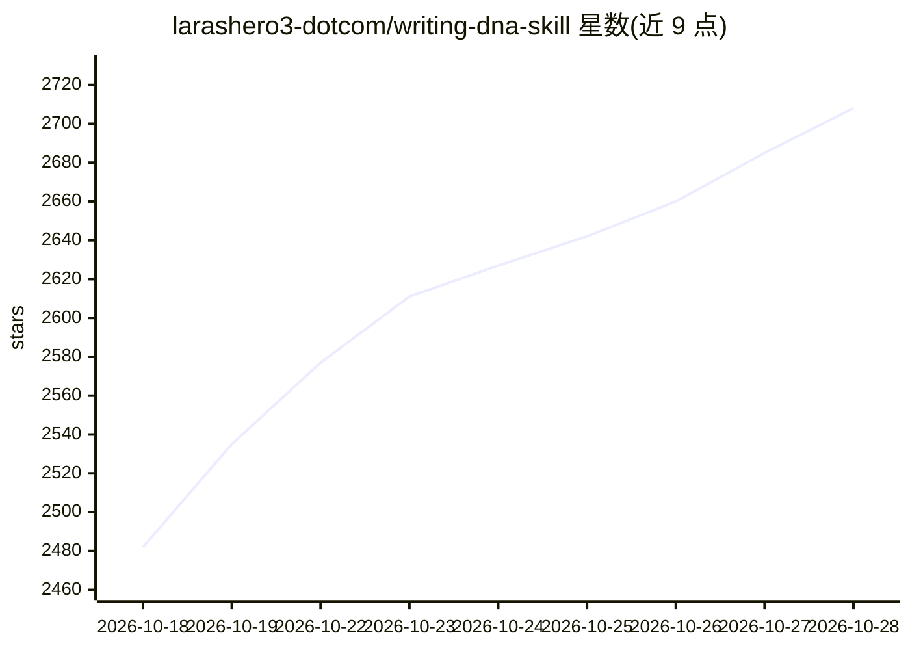

# larashero3-dotcom/writing-dna-skill

⭐ 2,734 · MIT · 推送 2026-08-24 · [GitHub](https://github.com/larashero3-dotcom/writing-dna-skill) · 组织维护 · 中文 README

**把任意作者写作风格蒸馏为可复用 Writing DNA 的 agent skill**

一个由 moxt.ai 制作的 agent skill（SKILL.md 格式）：引导 agent 对至少 20 篇完整文章做六层分析（语言、结构、选题、素材、认知框架、视觉风格），输出语言DNA.md、文章结构模板.md、写作视角与认知框架.md、视觉风格指南.md 及整合入口 Writing-DNA.md；写作前 agent 需重新读取全部产物并对照 5 篇原文校准。支持中英文产物分离，附随 lieflat-less-ai-tone 去 AI 味改写工序（白名单规则，经 300 篇 AI 输出与 329 篇真实文章对比实测）。面向希望复刻写作风格的 agent 使用者。限制：真实蒸馏需 20 篇以上语料，声明仅用于学习研究、不得冒充作者或侵犯版权。

## 筛选速览

| 维度 | 判定 | 备注 |
|---|---|---|
| AI 角色 | `ai-native` | 本体是模型或模型工具 |
| 许可风险 | `permissive` | MIT |
| 部署形态 | `None` |  |
| 模型依赖 | — | README 未给出锁定关系 |
| 硬件要求 | — | 无带数字的原话,不猜 |
| 安装摩擦 | `low` | 无编译、无系统依赖或容器化 |
| 成熟度 | — | 结构信号不足 |

## 能力要点

- 六层蒸馏（语言/结构/选题/素材/认知框架/视觉）产出分层风格文档
- 写作前强制重读全部蒸馏产物并按元数据筛选 5 篇原文校准
- 中英文产物分离处理，支持中文指令生成英文产物
- 附带 lieflat-less-ai-tone 去 AI 味白名单改写工序，与蒸馏产物冲突时以后者为准

## 适用场景

- 分析并沉淀某个账号或作者的个人写作风格资产
- 让 agent 在写作前加载风格文档，稳定复刻目标写作风格
- 对比同一主题下多个作者的表达差异
- 成文后用白名单规则清理 AI 痕迹

## 场景标签

`提示工程` `AI 写作` · 领域:Agent 开发

## 证据(README 行号)

> L5: 写作蒸馏器.skill：将任意作者的写作风格蒸馏成 Agent 可复用的 Writing DNA
> L13: 它并不是简单的“模仿某某风格”提示词，整个 skill 包含了一套完整的蒸馏流程，让 agent 把一批完整文章拆解成可复用的 Writing DNA，包括语言、结构、选题、素材、认知框架与视觉风格。蒸馏完成后，agent 可以在

## 星数曲线

2026-10-18 2,482 → 2026-10-28 2,708（+226）

---
*卡片 v1 · prompt 1.4 · 生成 2026-10-21 · 置信度 high · 依据 README sha `b3a09998a69f` · [字段定义](../../DATASET.md)*
