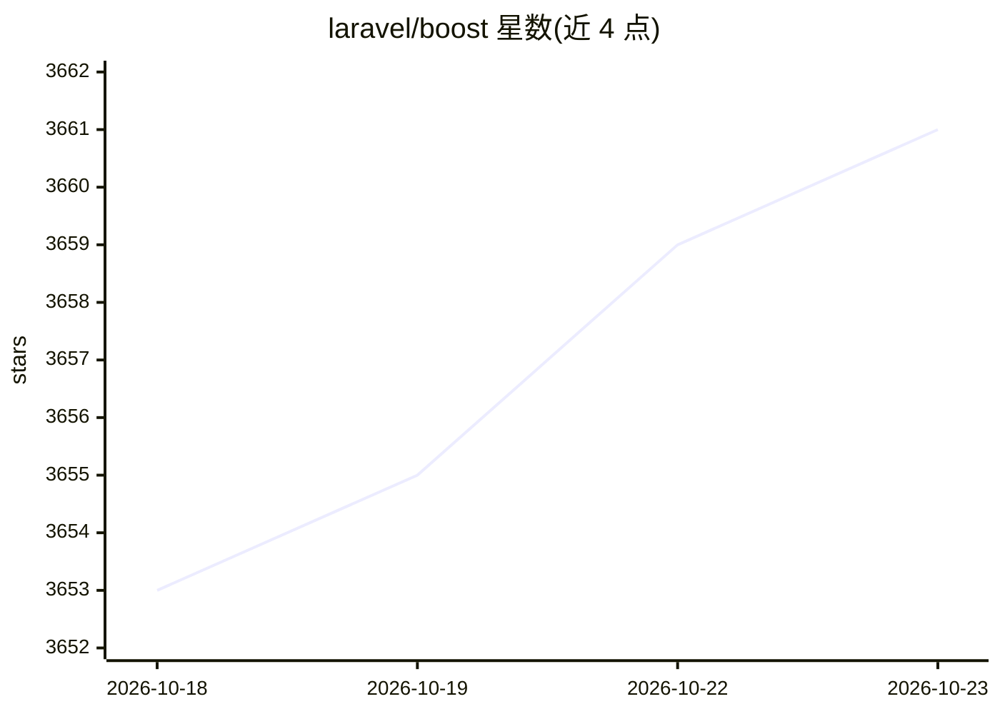

# laravel/boost

⭐ 3,661 · PHP · MIT · 推送 2026-10-17 · [GitHub](https://github.com/laravel/boost) · [官网](https://laravel.com/docs/13.x/boost) · 组织维护

**面向 Laravel 开发者的 MCP 服务器：为 AI 编码提供上下文**

Laravel 官方维护的 MCP 服务器，用于增强本地 AI 辅助开发体验：向 AI 工具提供生成 Laravel 专属代码所需的上下文与结构信息。README 仅含介绍、文档链接、贡献指引、安全漏洞报告说明与 MIT 许可声明，具体功能细节与安装方式指向 Laravel 官网文档。

## 筛选速览

| 维度 | 判定 | 备注 |
|---|---|---|
| AI 角色 | `ai-ecosystem` | LLM/agent 周边工具 |
| 许可风险 | `permissive` | MIT |
| 部署形态 | `None` |  |
| 模型依赖 | — | README 未给出锁定关系 |
| 硬件要求 | — | 无带数字的原话,不猜 |
| 安装摩擦 | `low` | 无编译、无系统依赖或容器化 |
| 成熟度 | — | 结构信号不足 |

## 能力要点

- 以 MCP 服务器形式为 AI 编码工具提供 Laravel 上下文
- 由 Laravel 官方组织维护并发布（含版本号与下载量徽章）

## 适用场景

- 在 AI 辅助编码环境中获取 Laravel 项目的上下文支持
- 本地开发时让 AI 工具生成贴合 Laravel 规范的代码

## 场景标签

`代码生成` · 领域:编码与开发

## 证据(README 行号)

> L11: Laravel Boost accelerates AI-assisted development by providing the essential context and structure that AI needs to

## 星数曲线

2026-10-18 3,653 → 2026-10-23 3,661（+8）

---
*卡片 v1 · prompt 1.4 · 生成 2026-10-20 · 置信度 mid · 依据 README sha `8c786fb18be9` · [字段定义](../../DATASET.md)*
