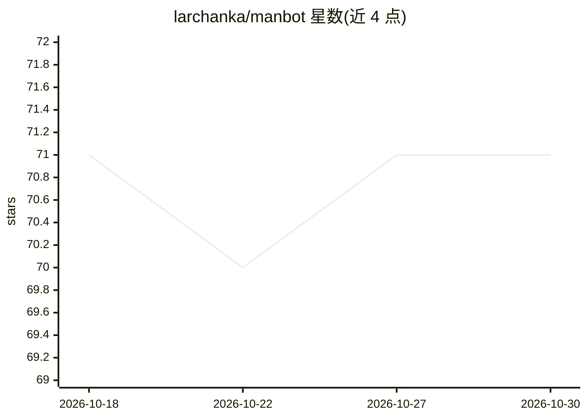

# larchanka/manbot

⭐ 71 · TypeScript · MIT · 推送 2026-06-12 · [GitHub](https://github.com/larchanka/manbot) · [官网](https://manbothq.github.io/) · 个人维护

**本地多进程 AI 任务执行平台：Telegram 交互，DAG 规划执行重任务**

多进程 AI 平台，通过 Telegram 接收任务，由 Planner 将任务规划为能力图（DAG），执行节点包含 LLM 生成、RAG、工具调用，可选 Critic agent 修订输出。全部推理在本地完成：LLM 与嵌入经由本地运行的 Lemonade（推荐 Qwen2.5 系列），音频转写用 Whisper，图像 OCR 用视觉模型，不调用云服务。附带会话记忆、会话级 RAG、自然语言提醒调度、Playwright 浏览器抓取工具和实时监控面板。需 Node.js≥20、本地 Lemonade 与 Telegram Bot Token。定位为处理耗时重任务而非聊天，性能依赖本机算力，响应慢于云端服务。

## 筛选速览

| 维度 | 判定 | 备注 |
|---|---|---|
| AI 角色 | `ai-native` | 本体是模型或模型工具 |
| 许可风险 | `permissive` | MIT |
| 部署形态 | `library` | 以包/库形式分发 |
| 模型依赖 | — | README 未给出锁定关系 |
| 硬件要求 | — | 无带数字的原话,不猜 |
| 安装摩擦 | `medium` | 含编译或系统依赖之一 |
| 成熟度 | — | 结构信号不足 |

## 能力要点

- Planner → Task Memory → Executor → Critic 多 agent 流水线，DAG 节点并行执行
- LLM/嵌入/转写/OCR 全部本地运行（Lemonade + Whisper），无云调用
- 类型安全 IPC：stdin/stdout 上的 JSONL + Zod 校验信封
- Playwright 浏览器抓取（含 stealth 反检测）与实时监控面板

## 适用场景

- 通过 Telegram 下达需要规划与多步执行的重任务（研究、工具调用）
- 本地离线处理上传的图片 OCR、音频转写与文档 RAG 入库
- 用自然语言设置一次性或周期性提醒

## 场景标签

`多智能体` `AI 助手` `RAG` `网页抓取` · 领域:Agent 开发

## 证据(README 行号)

> L5: A multi-process AI platform with type-safe IPC and capability-graph execution. Users interact via Telegram; the syst
> L9: > **Important:** This is **not** an AI chatbot. It is designed for **heavy tasks** that require time and substantial
> L20: - **File Processing**: Upload photos, documents, voice notes, or audio files via Telegram. Images are OCR'd locally

## 星数曲线

2026-10-18 71 → 2026-10-30 71（+0）

---
*卡片 v1 · prompt 1.4 · 生成 2026-10-24 · 置信度 high · 依据 README sha `05b7d2005344` · [字段定义](../../DATASET.md)*
